# CERB 2024 Hualien Earthquake QSM Demo

## 運用量子結構力學方法描述台大土木研究大樓2024花蓮地震動態過程

**學術交流工作草稿｜QSM-IM Published V8.0｜2026-10-17 數值成果｜科學驗證 OPEN**

> **本文件僅供學術團隊交流，請勿直接引用、轉載或作為正式研究結論的依據。** 文中的演算方式、數值結果及圖像仍在持續整理與驗證，相關資料與衍生成果的使用須遵守各來源的權利條件。

2024 年花蓮地震期間，臺灣大學土木研究大樓（Civil Engineering Research Building，CERB）記錄了地下層、中間隔震界面與屋頂的結構動態。本研究運用<strong>量子結構力學（Quantum Structural Mechanics，QSM）</strong>的關係場方法，嘗試描述地震加速度從地下層進入建築後，如何沿構件間的通道傳遞，在隔震界面改變波形，並於屋頂及其他結構位置形成不同的場域反應。本文所討論的計算成果凍結版本為 **V8.0**。建築隔震與監測背景參見文獻［1］，量子結構力學的理論基礎參見文獻［2］。

地震加速度資料由**國家地震工程研究中心**提供，建築資訊模型為<strong>臺大土木工程資訊模擬與管理研究中心（台大BIM中心）</strong>塑模演練歷史資料。研究從三個觀測層級、三個方向的量測出發，先辨識建築物件的空間佔據與構件關係，再將關係拓樸轉換為可演化的結構通道，依序觀察四種演化模式對測點波形與未量測空間的影響。

量子結構力學的長期研究關注結構力量與功率如何隨時間、位置及關係持續演化；然而，土木研究大樓目前可供此次實驗核對的主要物理量是**加速度**，因此先從具有正負方向的加速度歷時建立結構關係場，分析波形及空間分布。速度、受力與質量狀態尚不足以支持完整功率計算，本文討論的加速度、複數場範數與關係交換量，也就不直接作為結構機械功率、阻尼器耗能或構件損傷的證據。

本頁使用以 2026-10-17 最新計算成果核對的研究圖片、彙整表格與三支四模式同步影片，讀者可以直接沿著內文開啟對應成果。本儲存庫保留視覺化呈現與必要統計，不提供完整 0.005 秒加速度歷時、原始建築資訊模型、求解器或可重建整套演算的數值資料。

---

## 一、案例背景與三方向三層級觀測設計

CERB 是一棟中間樓層隔震建築。公開技術報告［1］記載，隔震層位於二樓與上部樓層的交界，設有 19 組鉛心橡膠支承墊，以及長向兩組、短向四組液態黏性阻尼器；建築設有多樓層加速度與隔震位移監測。原監測層級涵蓋 B1F、隔震界面上下樓層、6F 與 RF。本研究選用 **B1、ISO、RF 三個具有不同結構角色的層級**，各自選取長向、短向及垂直向具有正負方向的加速度歷時（Gal）。ISO 的具體感測通道與隔震界面上下側對應，仍按照原始 CH 映射表核對，不將泛稱 ISO 自動當成單一構件的反應。

### 1.1 三方向演化場

我刻意保留三個方向各自的地震波形與計算結果，因為它們面對的結構關係及界面條件不同。每個方向都有自己的 B1 輸入、ISO／RF 觀測與完整 IFC 關係場演化，讓同一棟建築可在相同拓樸下呈現三套方向性的加速度場。這三套場又可以回到同一個結構空間逐點對照，分析哪些特徵來自共同通道，哪些特徵呈現方向差異。

短向具有四組液態黏性阻尼器，長向配置兩組，垂直向則提供與水平反應比較的第三個方向；三個方向沿用相同的結構拓樸，分別輸入、演化與對照觀測，形成三套可相互檢查的加速度場。

**表 1｜三方向觀測設計**

| 方向場 | 為何選擇 | 想觀察的主要現象 |
|:---:|:---:|:---:|
| **短向** | 這個方向有四組液態黏性阻尼器，ISO／RF 的實測峰值均略高於 B1 | ISO／RF 的局部放大、頻帶變化，以及通道間反射／回返 |
| **長向** | 長向阻尼器配置為兩組，長向與短向的介面及結構路徑條件有差異 | B1／ISO／RF 振幅、相位及頻率的方向差異；局部通道放大及 RF 波形的可辨識性 |
| **垂直向** | 作為與兩個水平向對照的第三套實測方向場 | 樓層間垂直向波形如何傳遞與顯化、是否呈現與水平阻尼介面不同的振幅與頻帶特徵 |

選擇三套方向場，能讓同一套拓樸演算法在不同量測方向接受檢查。我關心三方向的通道演化是否各自合理，也關心方向之間的共同與差異表現；這些結果不預先被合併成單一三軸合量，以免抹除相位、正負振幅及各自的頻帶特徵。

### 1.2 三層級觀測

B1、ISO、RF 各有不同的觀測角色。B1 提供進入結構的來源歷時，ISO 顯示地震波經過隔震界面時的反應，RF 則用來觀察波在通道網路中傳遞到上部結構後的結果；它們是觀測層級的代稱，仍須與實際感測位置逐一核對。

**表 2｜三層觀測角色**

| 樓層層級 | 在研究中的位置 | 主要用途 |
|:---:|:---:|:---:|
| **B1** | 地震進入結構的輸入觀測層 | 提供外部驅動波，確認方向、振幅、相位與輸入時間歷史 |
| **ISO** | 中間隔震界面觀測層 | 檢查波抵達界面時的局部放大、頻率選擇、相位變化與回返訊號 |
| **RF** | 波經過下部結構及 ISO 界面後的上部觀測層 | 檢查經過整個通道網路後，哪些響應被保留、放大、衰減或重新組合 |

三個觀測層級共同形成 **B1→ISO** 與 **ISO→RF** 兩個可對照的觀測區段。每一段都能在 Transverse、Longitudinal、Vertical 三個方向上分別檢查振幅、相位、頻率與到達時間。研究採 0.005 秒取樣，主要觀察窗口為 39–47 秒，並保留較長完整歷時供演化與因果性分析。


### 1.3 實測與界面差異

在 39–47 秒的主要震動區間，我重新依感測通道核對三方向的 B1、ISO、RF 加速度歷時。長向使用 CH01／CH07／CH19，短向使用 CH02／CH08／CH20，垂直向使用 CH03／CH09／CH21。這次以各條時間序列的最高絕對加速度先確認層級的振幅尺度，再對照波形的正負變化、相位、頻帶及不同時刻的局部峰值。

同一方向的三個峰值未必出現在相同時刻，因此下表先比較各層的振幅尺度，再透過後面的實測波形追查峰值發生時間與形狀。

**表 3｜實測加速度峰值（Gal）**

| 方向 | B1 | ISO | RF |
|:---:|:---:|:---:|:---:|
| 短向 | 89.56 | 94.72 | 97.13 |
| 長向 | 75.62 | 96.76 | 95.90 |
| 垂直向 | 27.15 | 30.64 | 40.49 |

各欄為個別時間序列的峰值，峰值發生時刻可能不同。最新實測顯示長向 ISO 約 96.76 Gal、RF 約 95.90 Gal，短向 ISO 約 94.72 Gal、RF 約 97.13 Gal；垂直向 RF 約 40.49 Gal。峰值比例與 RMS、頻帶及相位反應須分別核對，才能辨識不同方向的界面演化。上述現象共同促成這次的問題：**在同一結構通道拓樸內，地震波進入不同方向場之後，如何經由節點互動、界面耦合、回返與頻帶重組，最後在三個觀測層級留下不同的加速度？**

沿著這些差異，本研究進一步處理 ISO 界面的頻率選擇性與觀測回饋，並依照 **模式一的歷史外推自由場 → 模式二的實測貼合輸入自由場 → 模式三的部分觀測導正 → 模式四的完全觀測錨定**，逐步研究同一結構場因輸入與觀測介入條件而發生的改變。這個順序也決定了本文的成果敘事與科學檢查順序。


**圖 1｜三層實測加速度**

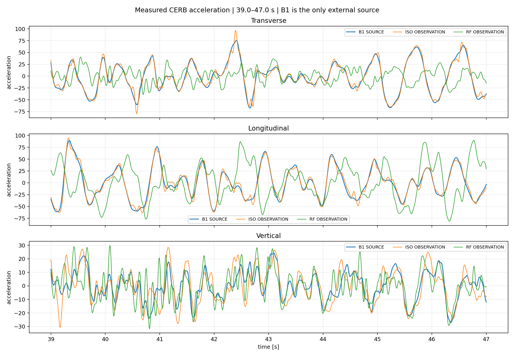


**圖 2｜三方向均方根比例**

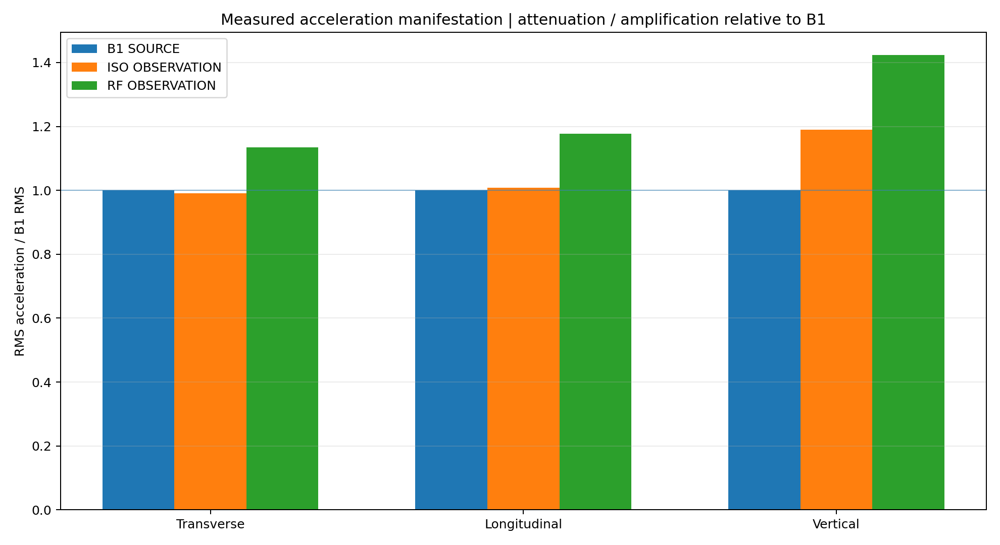

### 1.4 三層觀測之間的相對狀態

各層峰值和均方根能說明反應尺度，但一個結構場的演化也表現在不同觀測位置之間的相對關係。把短向、長向與垂直向的加速度放在同一個三維向量中，可以觀察 B1–ISO 與 ISO–RF 兩個區段的相對軌跡；另將向量幅值及角度隨時間展開，就能分辨相對反應的大小與方向如何共同變化。這兩張成果圖呈現的是**三方向量測構成的相對加速度狀態**，不能直接當成構件位移、力或已經量測到的耗散功。

**圖 R1｜三維相對軌跡**

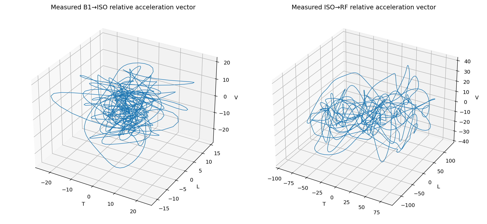

**圖 R2｜相對幅值與角度**

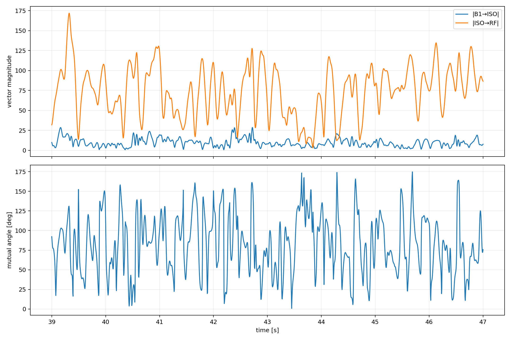


---

## 二、從建築資訊模型的空間佔據，建立可供地震演化的結構關係圖

要將 B1 的真實地震加速度放入整棟建築，我首先需要回答一個根本問題。建築資訊模型雖然有梁、柱、版、牆等構件及其幾何資訊，這些構件究竟透過哪些位置彼此接觸、鄰近或連接，原始物件清單並不會替我們完成判斷。如果直接用代表點之間的直線距離生成傳遞路徑，就會跳過結構實際佔據空間的證據。因此，這次花費大量運算時間的工作，是先重建全域空間佔據，才能由空間反過來辨識物件與物件之間的關係。

### 2.1 幾何與座標

第一步由 IFC 模型解析構件、樓層、物件識別碼及實體幾何，將各構件放回共同的三維世界座標系。模型曾發生建築資訊模型單位與幾何核心座標換算不一致的問題，若尺度被重複轉換，格點就可能離開真正的樓板、柱與牆，後續的接觸關係也會跟著失真。因此必須先核對整棟建築的包圍盒、樓層高度、物件位置與幾何尺度，再建立共同的觀測空間。

程式以構件的包圍盒縮小候選檢查範圍，再由實體幾何判定候選位置是否在構件內。這些幾何判斷都保留 IFC 物件身分，使後續即使收束成計算節點，也能追查回來源構件。

### 2.2 灑點與稀疏佔據

接著，以 **0.10 m 的固定間距**建立全域三維格點，逐一檢查每個格點被哪些建築構件佔據。這裡會得到三種基本結果。

**沒有物件佔據**，代表該位置在本次幾何模型的有效構件集合中為空，無須把它存成具有實體屬性的格點。**只有一個物件佔據**，則記錄格點與該 IFC 物件的對應。**兩個或更多物件共同佔據**，代表同一空間位置同時具有多個構件身分，可以成為辨識物件交會或可能接觸的證據。交會位置仍須配合幾何解析度與後續關係分類判讀，不能僅憑一個共佔據點就認定構造上的力學連續性。

同一個全域位置即使由兩個構件回報，也只保留一筆整數格點座標索引，在該位置附上全部 IFC 成員身分。空點不保存實體佔據紀錄，真正有值的格點才進入後續的空間索引，形成**稀疏的空間佔據表示**。這樣既能減少大量空間儲存，也能保存構件交界的原始證據。

本案例最後的有效觀測場規模約為 **950 萬個格點位置**。這個尺度必須採分構件、分片段的佔據運算、暫存、快取、失敗重試及結果重用，避免每次調整後面的求解條件就重跑整棟建築。這些格點負責描述空間與物件歸屬，**不會直接把 950 萬個點全數當成波動求解自由度**。觀測空間和求解空間需要分開，正是先前實作反覆遭遇運算負擔後建立的重要原則。

### 2.3 物件關係與代表節點

有了稀疏佔據索引，就能從格點反向掃描物件關係。第一種證據來自**共佔據**，也就是相同格點記錄了兩個或更多 IFC 構件。第二種證據來自有效格點的**空間鄰域搜尋**，本次使用約 **0.15 m** 的鄰域尺度，辨識來自不同物件的近鄰格點，並區分軸向、對角、跨樓層等相鄰情況。

一條物件關係的形成，應保留共佔據數量、鄰近路徑類型與物件身分，讓它可以回頭追查是哪些灑點支持了連接。對幾何上靠近卻未必直接受力連接的物件，也要保留這個限制。這裡使用的有效權重 $W=1/d_{\mathrm{eff}}$，描述的是固定格點尺度下的關係強弱。共佔據造成的零距離以一格解析單位處理，避免權重奇異；路徑數仍保存為關係證據，不直接當成額外倍率。這個有效距離**不直接等於材料波速，也不直接給出真實傳播秒數**。

完成掃描後，才回到構件群組。將同一結構計算群組內的大量有效格點，連同 IFC 身分、樓層、類別與空間佔據分布，收束為一個具有代表位置的**計算節點**；物件與物件之間由灑點支持的關係則轉成**連線**。因此，建築幾何轉化為由節點、邊及帶權入射關係組成的稀疏圖，可以直接接受後續複數場運算。

本次土木研究大樓最後形成 **1,649 個計算節點、7,101 條關係**。從約 950 萬個格點到這張結構圖，保留了兩種不同解析度的資訊。前者能說明構件實際佔據哪一段空間、哪裡發生交會；後者能讓每個通道有自己的演化狀態，並追蹤其與相鄰通道的互動。建立後仍須檢查節點度數、加權度數、連通分量及跨樓層關係，不能為了讓模型看似連通，就暗中加入缺乏幾何證據的橋接邊。

**圖 3｜結構通道拓樸**

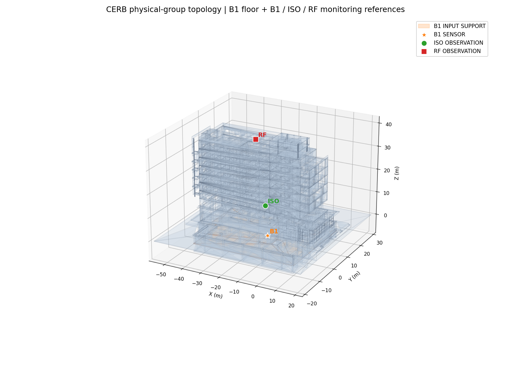


### 2.4 B1–RF 邊界聚焦

單有結構圖仍無法知道，一次數值上的節點交換應對應多少物理時間。必須讓實際觀測的邊界進來，才能把演化關係接到地震事件。本次以地下層 **B1** 作為局部受迫來源，並以 **B1→ISO、B1→RF 十組峰谷波包的匹配群組及其穩健中位數**作為關係傳播時鐘的候選參照。

這個 B1 來源也經歷過實作修正。過去把整片地下樓板收成一個受迫狀態，會讓地震同時進入過大的結構區域，抹除周圍構件之間的空間差異。後來保留地下層各 IFC 樓板物件作為獨立群組，從中挑選最接近 B1 感測位置的**單一局部樓板群組**接受輸入，讓波自行沿圖中的其他通道傳遞。

RF 是這次選定之觀測系統的上端參照位置；B1→RF 的多波包候選延遲可參與圖上的傳播時鐘調整，B1→ISO 則保留為獨立的界面檢查。多波包中位數仍有可辨識性與歧義，科學狀態維持 OPEN；它沒有把地震波硬指定成從 B1 走最短路到 RF。圖中的其他路徑、分叉、回返與關係耦合仍然存在。**ISO 位於兩端之間，特別保留作為隔震界面的獨立觀察位置**，用來檢查波到此處時的振幅、相位、頻率與延遲，不能把 ISO 的差異直接視為校正失敗。

於是，三維佔據場提供構件與交會位置，稀疏圖提供節點及關係，雙路徑波包提供地震時間尺度的候選校正依據，ISO 則讓我們能夠檢查中間界面的動態特徵。這樣建立的圖才開始成為本次地震波動演化的運算基礎。

## 三、通道基底、關係糾纏與 B–狄拉克場演化

在 10 cm 全域灑點、IFC 歸屬、物件群組及結構關係建立後，我重新理解了代表點的角色。**經灑點辨識而建立的代表計算單元，是結構中的一個通道；當這個通道進入演算，它就可以當作描述變化的基底。** 灑點保留了空間證據，代表通道則承接完整計算狀態，兩者之間的映射關係須可追溯。

當代表節點作為通道基底、邊作為關係基底時，完整的複數場便可由兩組狀態共同描述。節點承接局部輸入與加速度顯化，關係保存通道之間的耦合及交換，兩者在同一個演化過程中持續更新。令 $|c_i\rangle$ 與 $|e_j\rangle$ 分別表示第 $i$ 個通道及第 $j$ 條關係的基底，結構場可寫為

```math
\Psi(t)=\sum_i q_i(t)\lvert c_i\rangle+\sum_j\eta_j(t)\lvert e_j\rangle
```

其中 $q_i(t)$ 與 $\eta_j(t)$ 分別是節點及關係的複數狀態。這套表示保留了不同通道相互作用所造成的振幅、相位與回返，使模型可以從整棟建築的關係而非個別節點的孤立反應，研究地震波的演化。

地震波由 B1 局部通道輸入時，外部波與各通道已存在的狀態交互作用，導致振幅、相位與頻率組合隨時間改變。波在通道間交換、疊加、干涉及回返的過程，是我希望從完整結構拓樸中直接觀察的內容。**節點與節點之間的關聯，我以「關係糾纏」來描述，現階段透過節點–關係耦合與觀測回饋演算法表達。** 這個概念是本研究理論及演算法的組成部分。

通道作為變化基底，也逐漸形成我在這次實作中更清晰的演算構想。**未來希望把這張結構圖視為地震波進入建築後的通道系統**。圖上的節點代表承接變化的量子單元構想，邊代表通道間的關係；在本次演算法裡，這些關係由節點與關係的複數耦合表達，我稱為「關係糾纏」。若將來具備合適的量子運算條件，可以研究如何把通道狀態與關係編碼成量子邏輯位元及其耦合操作。目前成果仍是在傳統電腦中完成的數值演算，這個方向屬於從本次結構圖實作延伸出的下一步研究。


建築資訊模型與灑點已經建立了計算通道，下一個問題是如何讓這些通道在地震輸入後持續互動。本研究選擇 **B–狄拉克厄米特哈密頓算子**，核心理由是研究重點放在**結構通道之間的關係與交換**。目前沒有另外替每個節點指定對角的局部勢能或自作用項，也沒有預先把振幅增減結果寫進各節點的對角值。演化首先由節點與關係的耦合發生。

由結構拓樸建立帶權入射矩陣 $B$，再將節點與關係的複數狀態合併為完整的演化向量。B–狄拉克算子的兩個對角區塊維持為零，讓通道與關係的雙向耦合成為波動變化的主要來源。

```math
H_B=\frac{\Omega}{\sqrt{2}}\begin{bmatrix}
0 & B \\
B^{\dagger} & 0
\end{bmatrix}
```

地震波作用於通道後，節點狀態經由非對角耦合影響相連的關係，關係狀態又回饋其相鄰節點。隨著這種往返更新，逐步顯化出結構場的震盪、波形變化、局部集中、干涉與回返。

從數學結構看，反覆耦合作用的節點部分可連結至 $BB^{\dagger}$ 形式的關係拉普拉斯。因此即使原始 Hamiltonian 的兩個對角區塊為零，各節點仍會因為鄰接關係而表現出有效的局部動態。這正是我希望保留的機制：**由關係的更新讓波動顯化，先研究結構通道如何互動，再觀察各位置實際出現什麼加速度。**

時間推進採用 Crank–Nicolson（CN）／Cayley 更新，在完整複數節點與關係空間中持續演化。研究的觀測時間間距為 0.005 秒；數值積分使用內部子步維持精度。相同結構通道拓樸分別接受短向、長向與垂直向輸入，共形成四模式 × 三方向的 12 組演化實驗。

節點加速度的主要顯化量為具有正負方向的 $\mathrm{Re}(\Psi_a)$，單位 Gal；虛部、關係複數狀態與其交換過程另外保留，用來追蹤相位及通道回饋。場的數學範數與關係交換代理量，則分別按照既有數學定義解讀。


**圖 4｜節點與關係交換**

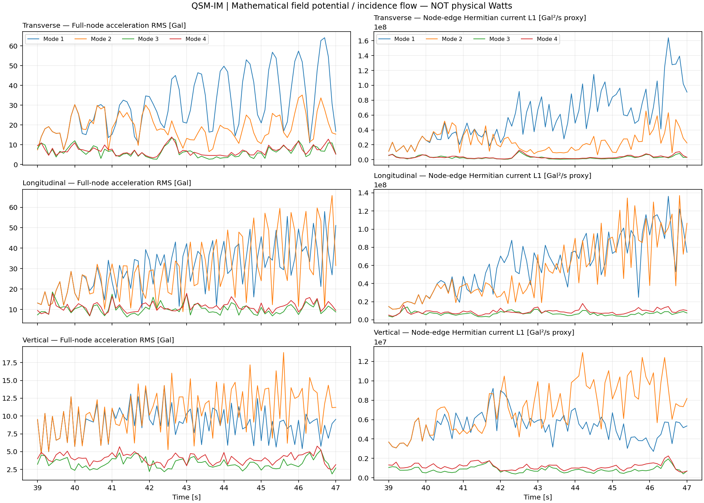


### 三套方法如何銜接

在這棟建築的實驗中，<strong>量子結構力學（Quantum Structural Mechanics，QSM）</strong>提供以關係探討結構動態及功率演化的問題框架；<strong>量子拓樸快遞方法（Quantum Topology Express Method，QTE）</strong>進一步處理結構圖上的通道、關係及波動演化；<strong>碎形生機拓樸演化論（Fractal Alive Topology Evolution，FATE）</strong>則從觀測介入後的狀態更新與持續演化，研究既有場如何受到新資訊的影響。三者在這個案例中共同指向加速度場的實驗，功率與耗能仍須等待速度、受力及材料資訊進一步建立。

| 理論層次 | 本次案例中的研究角色 | 目前可以由哪些成果觀察 | 尚待處理的問題 |
|:---:|:---:|:---:|:---:|
| **量子結構力學** | 把構件間的關聯視為承接與交換變化的通道，並建立可與完整波動場比較的關係基準；長期目標是功率演化 | 三方向的通道拓樸、局部加速度及關係場診斷；研究程式另有獨立關係基準的計算路徑 | 現有展示成果尚無可獨立呈現的三軸關係基準對照表；功率相關物理量也尚未完成 |
| **量子拓樸快遞方法** | 讓節點與關係共同承接完整複數狀態，透過兩個對角區塊為零的 B–狄拉克算子及時間演化顯化波動 | 模式一的歷史外推自由場、模式二的 B1 持續輸入自由場，以及三軸全場加速度分布 | 波包時間尺度、局部放大、相位及未測空間仍需獨立的物理比較 |
| **碎形生機拓樸演化論** | 研究觀測如何回到既有結構場，改變當步狀態及下一步演化 | 模式三的部分導正、模式四的三個實測錨點同步、Prior／Post 波形與全場統計 | 部分導正目標是否達到、未測空間是否可靠、觀測回饋能否支持前瞻推論 |

四模式將這些方法接到可比較的加速度觀測。模式一保留歷史函數外推後的自由演化包絡，模式二緊貼真實輸入觀察原生通道波動，模式三以 ISO／RF 逐時觀測導正波形及關係，模式四則將三個測點直接貼合，研究更強的觀測介入如何改變其餘結構空間。各模式共享結構拓樸與時間演化機制，因而能在相同的空間基礎上逐一比較。

量子結構力學的獨立關係基準與量子拓樸快遞方法的完整節點–關係波動表示，仍保留不同的演算意義。本文已有足以討論的自由場波形、觀測導正和全場統計；獨立關係基準尚無可供本頁呈現的三軸對照結果，因此不為它填入推測數值。碎形生機拓樸演化論相關的觀測回饋，則由下文模式三、四的既有波形與場域成果繼續討論。

### 加速度研究邊界

量子結構力學後續仍會進入結構功率演化，本次則先以可追查的**結構加速度關係場**建立實驗基礎。我選擇從真實地震三層級量測開始，因為現有訊號能直接檢查每個時間步的加速度正負、波形相位與頻帶、界面局部放大，以及觀測導正後的場分布。這些結果讓通道與通道之間的互動具有可觀測對象，也為未來連結受力、速度、功率及耗散建立基礎。

節點與關係的複數更新可用來表達本研究所說的「關係糾纏」，但目前只對應已建立的數學耦合與動態回饋。量子邏輯位元的編碼仍是後續研究方向；本文不以這個遠期構想取代 CERB 的實際加速度結果。

---

## 四、輸入處理與四模式的實驗目的

### 波包與時間尺度

這次保留 B1 在 40 秒以前可辨識的十組峰谷波包，逐組辨識峰值、谷值與相位特徵，再分別對照 ISO、RF 的到達差、相關性、振幅與相位。匹配結果依 B1→ISO、B1→RF 兩條路徑分開保存，先檢查哪些波包具有足夠的匹配證據，再以支持群組的穩健中位數及 MAD 檢查候選延遲的集中程度。未能辨識的波包與多重匹配候選仍保留在科學 OPEN 紀錄中，不讓任何單一次首次越閾波前主導整個場的時間校正。

六組路徑的中位候選分別為：長向 B1→ISO 約 **0.015 秒**、B1→RF 約 **0.200 秒**；短向 B1→ISO 約 **0.015 秒**、B1→RF 約 **0.165 秒**；垂直向 B1→ISO 約 **0.200 秒**、B1→RF 約 **0.015 秒**。這些數值分別描述兩個觀測對照路徑的波包延遲候選，不能把兩者直接相加，或將某個方向的單一候選解讀為已確認的真實波前。

長、短向採 RF 支持群組的中位候選參與 B–狄拉克／CN 相位時鐘，ISO 匹配結果保留為中間界面的獨立核對。垂直向的兩條路徑呈現不一致的候選特徵，因此仍以參考相位速率進行探索。時間尺度是否真能對應結構內的物理傳播，後續仍須以獨立波前辨識、跨測點相位與單位波檢驗；這部分維持**科學 OPEN**。

**RF 的匹配群組提供時間尺度候選，ISO 則保留界面的獨立動態差異。** 這樣可以觀察波抵達中間層時的振幅、相位及頻率改變，並用三個方向檢查同一關係建模方式在不同結構路徑的表現。這些差異也是後續 模式三進行通道頻帶導正的重要觀測資訊。


本研究的四模式以相同 CERB IFC 拓樸、同一套 B-Dirac／CN 節點–關係演化器與三個方向的地震輸入為共同底盤。之所以設計四模式，是要控制「接下來會取得多少輸入與觀測資訊」，再看這些條件如何改變九組測點對照，以及最重要的 **1,649 個節點與 7,101 條關係所構成的完整場**。

這四個模式的研究邏輯有先後。模式一探索在只有既有歷史時，單機能把後續地震波形與全場演化擬似到什麼程度；模式二以真實 B1 一步一步貼著地震看自由關係場究竟會如何動；模式三在這個自由計算場之上納入 ISO、RF 的逐時觀測，把波形向量測導正至少一半作為實驗目標；模式四再將三個層級的實測點當步直接更新到位，觀察另一種重建條件下全場變了多少。

這四個模式的評價因此也各自不同。模式一要談**外推、包絡、可預警時間與錯誤警報**；模式二要談**原生通道演化與實測一路相伴的觀察**；模式三要同時談**部分導正幅度、波形相關性及場的重新分布**；模式四要談**三點完全同步後未量測空間的重建與變動**。

### 模式一｜歷史外推

模式一的出發點，是先問：如果未來具有超級電腦的運算條件，可以持續取得某個時刻以前的地震資料、更新輸入模型，進一步讓整個建築的結構關係場高速演化，那麼從已知歷史推得的下一段地震及全場包絡，究竟可以走多遠？這一次先使用單機做一個可以實際執行、可以和事後量測比較的探索實驗。它驗證的是演算法所形成的外推情境，尚未進行超級電腦效能比較。

凍結成果以 B1 已經發生的歷史訊號訓練獨立輸入函數。診斷紀錄的訓練截止時刻為 **40.0 秒**；在截止前，函數依 B1 歷史建立，截止後則由擬合函數持續外推，驅動其獨立的完整節點–關係場。它不使用截止之後的實測 B1 補值，也不把 ISO、RF 的事後觀測偷偷當成模型輸入。原始紀錄保存了 4,422 筆訓練樣本、1,400 筆外推樣本，以及各方向的頻率成分、源訊號連續性與包絡指標。

我希望檢驗的第一件事，是外推函數是否能繼續提供具有振幅、頻率與來回震盪的輸入。若函數在截止點立刻平掉，即使計算非常穩定，也無法探討結構場後續的強響應與預警。第二件事，是既有關係場與外推輸入的疊加，會不會在某些構件形成**全場包絡**，例如振幅的擴張、收束、局部尖峰與跨樓層傳遞。第三件事，才是把這種包絡與之後真的發生的 ISO／RF 響應對照，量出究竟有多少**提前量**，是否存在漏報、誤報及對時間窗、閾值敏感的問題。

因此，模式一的可用性應分成三層判定。第一層是 B1 輸入函數自身的外推品質；第二層是全場包絡及各節點極值隨時間的演化；第三層是將事後實測保留為獨立檢驗時，是否真的能形成足夠提前時間與可接受誤報率。**現有成果已完成前兩層的部分數值展示，第三層仍需要正式預警判準與留出資料試驗。**

這裡曾出現一個實際失效：早期把 模式一寫成「B1 到 40 秒停止輸入後自由場」，導致來源突然切換；另有版本在切換點出現明顯跳變。現在的研究設計使用**歷史 B1 訓練函數持續外推**，仍由完整場自由演化，並要求將截止前後的源訊號連續性列入科學驗收。此處的「自由」是指外推後不靠未來實測回填、由函數與原有結構關係自主演化。

凍結成果中三個方向的模式一外推來源 RMS 與訓練末段 RMS，分別記錄為短向 **24.30／31.98 Gal**、長向 **20.16／25.41 Gal**、垂直向 **8.17／9.80 Gal**。這證明輸入函數在此實驗設計中仍保有非零的震盪振幅尺度；它們本身尚無法證明未來地震預警成功。

### 模式二｜持續輸入

模式二的問題是：當 B1 每一步都貼著當下真實量測輸入，結構通道在**完全沒有下游觀測回饋**時，會顯化什麼？與模式一相比，這次不用擬似未來的 B1。每 0.005 秒接受真正已到達的 B1 的帶正負號加速度，讓 B-Dirac 零對角的節點–關係耦合自行推進，ISO 與 RF 保留為獨立觀察點。

這提供一條極重要的自由場基線。現在可以在每一個相同時間點，同時看 B1、ISO、RF 的真實波形與模型輸出，觀察其通過介面的振幅、相位、頻帶變化，並把同一時刻全場的高值、關係交換與空間分布放在一起。這種「貼著看」使場的變化可追溯到當步輸入及先前場歷史，也讓下一個研究問題變得清楚：當 ISO／RF 和自由場不同，到底哪些差異可能來自有效通道關係尚未辨識？

模式二特別保留振幅的自由放大，也保留傳播、干涉、反射與回返的數值可能性。這個模式曾有過一個直接影響實驗成立的失效：**B1 明明持續輸入，ISO 與 RF 卻幾乎沒有顯化可辨識的振幅**，使自由通道場在兩個下游觀測位置失去必要的波動表現。這與模式一的輸入函數外推失效有相似的表面現象，卻屬於不同的檢驗位置。模式一必須查歷史輸入函數及其外推包絡；模式二的 B1 來源已知，因此要查 B1 局部來源是否進入關係算子、節點與關係狀態是否向下游傳遞、感測錨點是否映射正確，以及讀出的加速度是否仍具有可辨識的正負震盪。

另外，程式歷程還曾發生源點加速度反相、B1 被當作內部自由預測目標，以及替換算子造成傳播延遲異常等問題。因此 模式二的通過條件不能只有「B1 正常」，**ISO、RF 必須從同一份演化場自然得到可查驗的波形、振幅與到達特徵**，並與實測分開比較，不以人為貼值補足振幅。這條自由場基準成立，後續兩種觀測介入才有科學上的對照依據。

### 模式三｜半程導正

模式三是研究設定的**部分波形導正實驗**。先讓 B1 當步輸入驅動全場，保存完整的節點及關係觀測前狀態（Prior）。再把已經取得的 ISO／RF 實測歷史與 Prior 波形，在相同時間與頻帶上比較振幅、相位及頻率，導正通道關係與當步複數場，形成觀測後狀態（Post）。Post 及更新後的關係繼續進入下一步 CN 演化。

本研究希望在這個實驗中，Post 的形狀能相當明顯地朝實測波形修正，**至少向實測波形走完約一半的差距**，再量化相關係數提高多少、RMSE 降多少，以及這個更新如何改變沒有直接量測的結構場。這個「一半」需要獨立記錄，不能只用一個全域縮放倍率，或以相關性改善代替。對於觀測值與觀測前狀態有明確差距的時刻，導正比例可定義為

```math
f_{\mathrm{corr}}(t)=\frac{a_{\mathrm{post}}(t)-a_{\mathrm{prior}}(t)}{a_{\mathrm{measured}}(t)-a_{\mathrm{prior}}(t)}
```

當差距接近零時，比例會失去穩定意義，需要排除低於明確容差的時點，並另列比例的時間分布。比例表示往觀測方向移動的程度，不能取代對複數頻帶創新、相位、頻率、局部峰值時刻及完整拓樸場的檢查。

**此次凍結成果尚未完全達到這個目標。** 依據 39–47 秒六組 ISO／RF 共 9,606 筆觀測前、觀測後及實測加速度時間資料核算，得到六組導正比例中位數約 **33.5%–37.1%**；目前單步比例最大約 **45%**。另一方面，同一批成果確實顯示六組相關係數全部提升、RMSE 全部下降。因此，這一階段已驗證「觀測輔助的波形導正會實際作用」，而實驗設定的「至少半程」仍應列為**後續明確的科學驗收要求，現有 V8.0 未達標**。兩件事必須分開寫。

另一個不可忽略的部分，是全場變化。目前模式三當步觀測錨點的波形已有明顯差異，但由實際全場快照看，Prior 與 Post 的 P99、RMS 及最大值差異還相對有限。因此，研究要繼續追蹤當步修正的空間作用範圍、節點與關係狀態的傳播，以及後續多步累積如何讓全場改變。**測點波形變好之後，場究竟改變了多少，才是這個模式下一層的科學問題。**

### 模式四｜直接同步

模式四沿用 B1 當步真實輸入及同一個完整場演化器，先保存 Prior。到了觀測時刻，B1／ISO／RF 的當步帶正負號的加速度 直接更新至對應的觀測錨點，形成觀測後狀態（Post），再由這份被更強制約束的場延續至下一步。

模式四想問的是，如果已經知道三個層級當下真正的加速度，**完整結構場被迫接受這三個邊界觀測後，其餘 1,646 個未直接觀測的計算節點與 7,101 條關係會產生多少差異？** 哪些空間的局部高值會消退？哪些會保留？哪些反而出現新的集中？節點間的回返與相位場如何發生變化？這些變化又會如何影響下一步 Prior？

此模式的觀測錨點 Post 與 Measured 在程式定義下應精確相等，因此這些錨點的相關係數為 1、RMSE 為 0。這是一個必要的同步檢查，**用來證明「已知三點強制貼合」真正完成**。研究成果要繼續往沒有直接量測的全場看，並與模式三的部分導正場作差，觀察強、弱兩種觀測介入對場的不同影響。

### 四模式比較


表 4 是四個獨立研究條件的比較。模式一、二保留自由演化，模式三進行部分觀測導正，模式四強制觀測同步；後面六章的數據依此順序呈現。

**表 4｜四模式實驗設定**

| 模式 | 主要實驗 | 要看見的場現象 | 科學驗收重點 |
|:---:|:---:|:---:|:---:|
| **模式一** | 單機模擬歷史 B1 函數外推、獨立場自由演化 | 外推後的波形、頻帶、完整場包絡、局部峰值是否提前顯化 | 外推源連續性、包絡覆蓋率、閾值、預警提前量、漏報與誤報；未做者列 尚待驗證 |
| **模式二** | 真實 B1 一步一步貼著輸入，ISO／RF 保持觀察 | 原生通道傳播、放大、干涉、回返，及其與三層實測差異 | 同時刻波形、到達差、局部高值、全場 P99／RMS、關係流 |
| **模式三** | ISO／RF 振幅、相位、頻率持續部分導正 | Post 相較 Prior 的波形修正與完整場變化 | 實際導正比例是否達半程、r／RMSE、頻帶創新量、場內擴散、後續 Prior |
| **模式四** | 三個觀測層級當步強制同步 | 觀測點到位之後，未觀測空間的重建與下一步演化 | 三點貼合精度、未測節點變化、局部峰值、空間分位數、場的連續性 |


---

## 五、ISO 阻尼介面與三套方向場的研究假說

這棟建築的中間隔震層具有長向兩組、短向四組液態黏性阻尼器，並與鉛心橡膠支承墊共同構成隔震系統。公開報告［1］已整理其地震表現；本研究從三層級具有正負方向的加速度與全場演化，繼續追問通道的頻帶及相位響應。

我把三個樓層的角色分開，是因為隔震界面的作用會因為波形、通道與觀測時刻而不同。B1 提供入射訊號，ISO 讓我觀察波抵達中間界面時的顯化，RF 則提供界面之後的上部響應。若只看 B1 和 RF，會少掉波在中間層曾經局部放大的資訊；若只看 ISO 峰值，又可能忽略同一段波形在 RF 已有不同的頻率與振幅組合。因此我希望能同時看三個位置的完整時間序列，也把所有計算節點放回同一個空間場檢查。

短向實測的 ISO 峰值 **94.72 Gal**，比 B1 的 **89.56 Gal** 略高，RF 最大約 **97.13 Gal**；長向 ISO 最大 **96.76 Gal**，RF 約 **95.90 Gal**，仍呈現不同的關係；垂直向 ISO、RF 則各有其響應尺度。以此次 39–47 秒三層實測歷時計算，短向 RF/B1 的 RMS 比約 **1.134**、長向約 **1.177**、垂直向約 **1.424**。三個方向的加速度尺度各有其變化，仍須結合對應的振幅、相位及頻帶檢查。

我把 ISO 看成具有多路徑、頻帶選擇、相位變化及回饋特性的**阻尼介面研究對象**，其有效響應由原生結構拓樸與觀測約束共同形成。模式二顯示不加入下游回饋時，該介面會在自由演化中出現什麼；模式三嘗試以實測波形辨識哪些頻率與相位需要導正；模式四提供三層級已知時的強觀測重建對照。三套方向場讓同一研究假說受到長、短向阻尼配置及垂直向波形的不同檢查。

我特別希望在時間軸上分辨四種不同的表現。第一是入射波到達 ISO 的延遲與相位；第二是 ISO 是否顯化更高的局部加速度；第三是同一波包繼續向 RF 傳遞後，其振幅與頻率成分是否重新分配；第四是波經過關係耦合後，是否從其他路徑返回下部節點。這幾個現象應回到短向、長向與垂直向的分別觀測，才有機會釐清阻尼介面的有效通道行為。

在目前的演算設計中，隔震界面沒有被預先指定成固定的衰減倍率。模式二的原生關係場允許局部高值形成，模式三再用每一步 ISO／RF 的振幅、相位與頻帶創新調整 Post，模式四則給出直接觀測錨定的極端條件。這讓「同樣經過 ISO，為何某些頻率或方向的反應改變比較明顯」成為可以跨模式比較的問題。

在這個階段，ISO 與 RF 的峰值、RMSE、相位差與相關係數可以說明**加速度場如何顯化與被修正**。阻尼器實際耗能、結構機械功、材料剛度、構件損傷，仍須等速度、力、位移及相應物理定義有足夠證據後，才接到後續研究。此處保留零對角 B-Dirac 的關係主導形式及可選的開放耗散研究分支；不為了符合某張圖，將對角勢能、外加裁切或固定放大值塞進主實驗。

---

## 六、四模式數值成果與全場加速度特徵

前面已經說明四種演算條件如何逐步增加輸入與觀測資訊；接下來把結果放回各自的研究目的，從歷史外推、持續輸入、部分導正一路讀到三點直接同步。每種模式都對照九組觀測波形及完整結構場，讓測點相關性、空間高值與觀測回饋在相同的研究問題下比較。

這些成果以 **39–47 秒**的主要震動區間進行測點比較，相關係數按照同一時間點計算，不為提高相關性移動波形。空間統計則由 **1,649 個計算節點、102 張持久化快照**構成；單張快照、跨快照最大值及完整 **5,821 個求解時間步**各有不同的統計範圍，以下均依其來源區分。

### 模式一｜包絡與高值

由 B1 歷史訓練而成的輸入函數，在 40 秒之後自主外推。訓練源歷時與後續預測源的紀錄已具備，可觀察外推開始時的波形連續性。三方向的訓練末段與外推來源 RMS 已在上節列出，顯示此一實驗的外推訊號仍保留一定振幅尺度。

在完整結構場，102 個持久化快照出現下列最高絕對加速度。這是 模式一能形成全場局部強響應的直接結果，也是之後要討論包絡、閾值及提前量時必須回看的資料。

下表先放入場內單點的最高加速度，以及第 99 百分位數與全場均方根，接著列出 ISO、RF 波形與實測的相關性。它將空間振幅與下游波形放在一起比較，但兩種指標的意義仍各自獨立。

**表 5｜模式一數值成果**

| 模式一自由外推場 | 短向 | 長向 | 垂直向 |
|:---:|:---:|:---:|:---:|
| 全場最大絕對值（Gal） | 338.03 | 469.20 | 124.39 |
| 各時點最大 P99（Gal） | 104.26 | 142.19 | 46.23 |
| 各時點最大 RMS（Gal） | 43.67 | 65.24 | 11.39 |
| ISO 波形 Pearson r | 0.060 | -0.083 | -0.215 |
| RF 波形 Pearson r | 0.015 | 0.138 | -0.004 |

前三列分別描述全場的單點最高值、較大範圍的高振幅分位數及整體空間尺度；最後兩列則是 39–47 秒的實測測點波形對照。現在最需要追的是 **40 秒之後包絡如何發展、強響應究竟在什麼時候出現、是否先於事後實測事件**。目前尚無正式計算的包絡覆蓋率、告警門檻、領先時間、漏報與誤報成果，應維持 尚待驗證。模式一目前展示的是可計算的外推全場與探索性高值，預警潛力仍需要下一階段定量檢驗。

**圖 5｜模式一短向場**

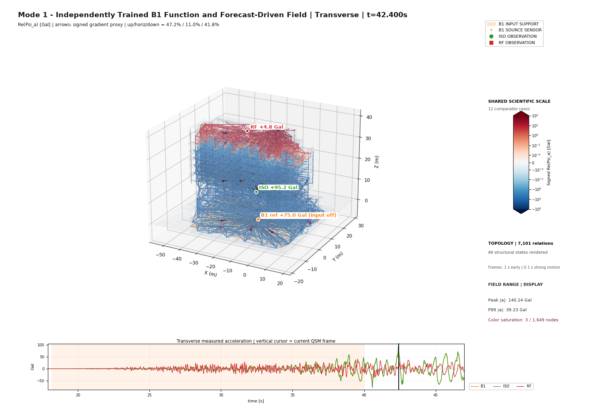


**模式一｜三方向計算與實測波形**

以下三張原始 Structural Response 成果圖依序對照短向、長向與垂直向的 B1、ISO、RF 波形。這些圖是模式一的直接計算成果，原有的比較曲線與時間軸完整保留。閱讀本模式的數值表時，應同時觀察實測與計算的**正負振幅、相位及時間歷程**，避免只由單一相關係數或極值推論整段地震反應。

**短向｜波形**

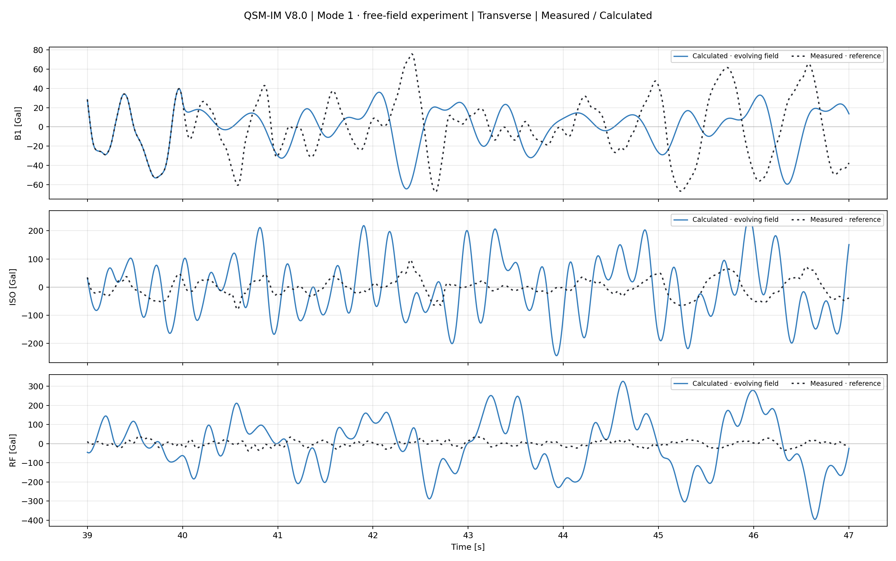

**長向｜波形**

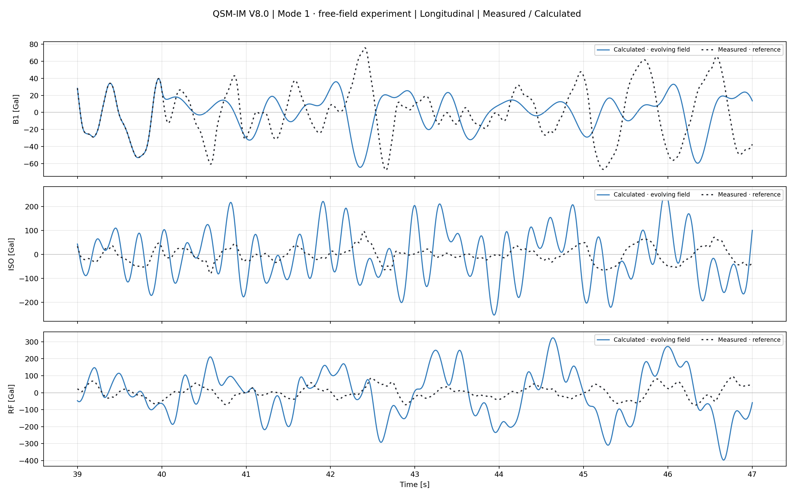

**垂直向｜波形**

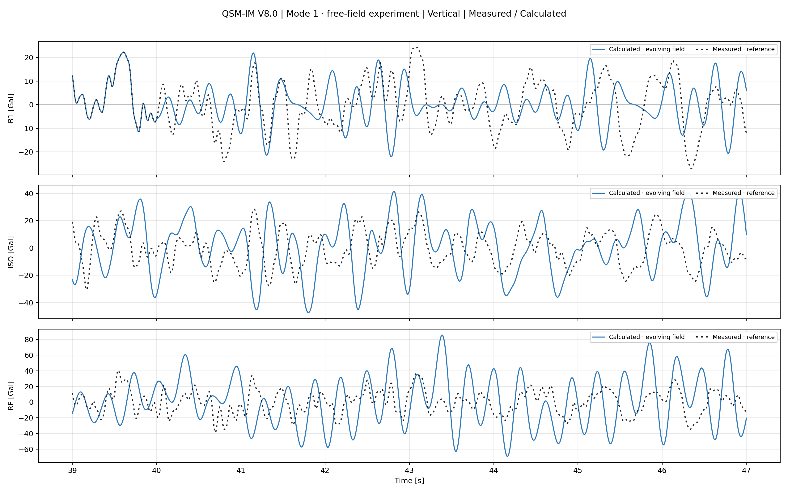

**模式一｜加速度時間趨勢**

這一組較長時間的加速度趨勢圖，上半部顯示 B1／ISO／RF 實測歷時，下半部顯示相應 ISO／RF 計算歷時。圖例中沿用的「ISO OBSERVATION」「RF OBSERVATION」是程式對觀測位置的名稱，下半部曲線仍為求解器計算值；這兩條曲線並不等於 ISO／RF 的真實測值。各方向縱軸尺度應分開閱讀，完整 1,649 節點的空間分布則回到場影格及演化影片。

**短向｜場趨勢**

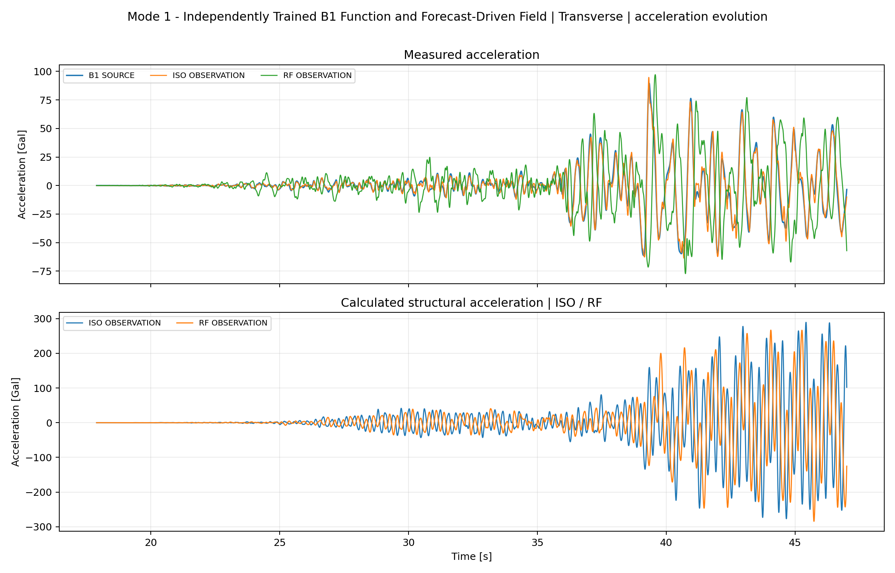

**長向｜場趨勢**

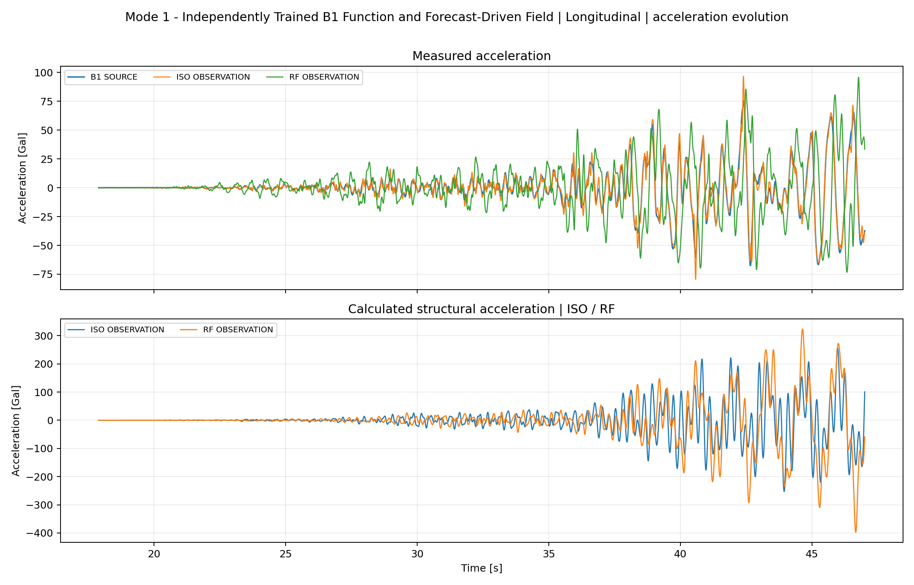

**垂直向｜場趨勢**

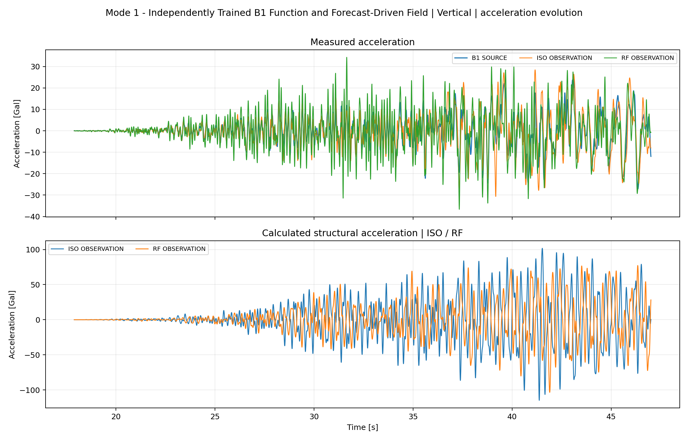

<details>
<summary>模式一｜42.400 秒三方向場影格</summary>

| 方向 | 42.400 秒場影格 |
|:---:|:---:|
| 短向 |  |
| 長向 | 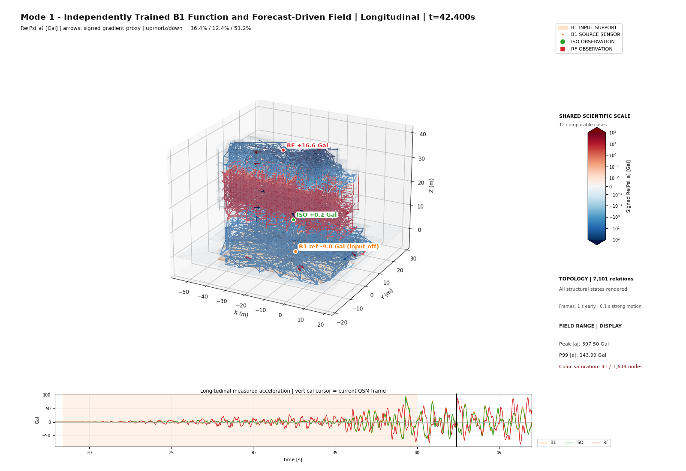 |
| 垂直向 | 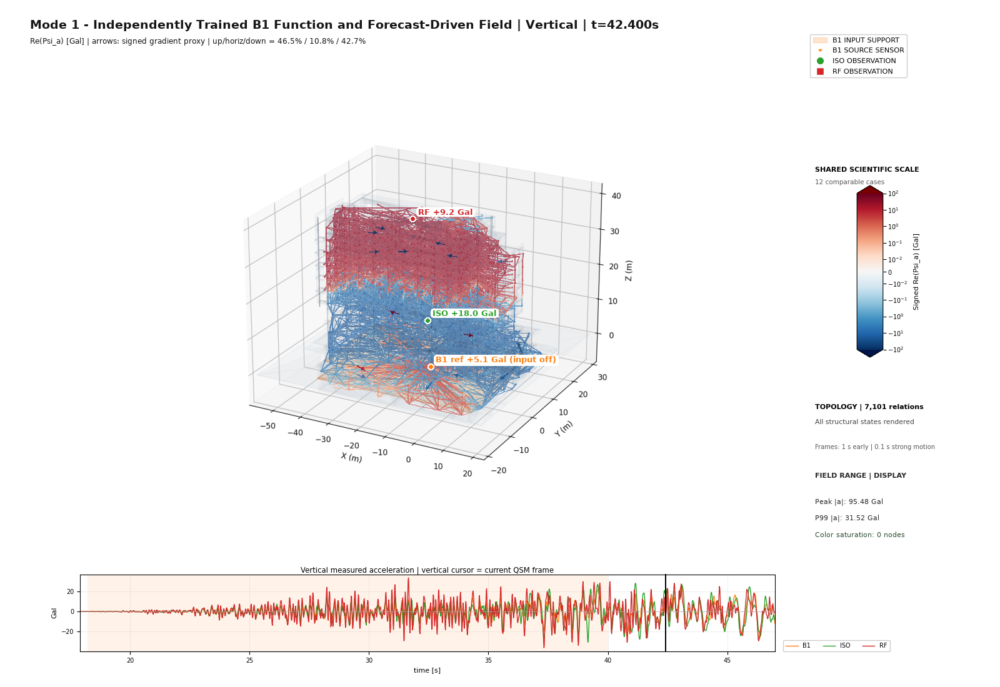 |

</details>

### 模式二｜自由場

模式二在每一步都得到真實 B1，因此源點與後續演化具有可追查的輸入對照。實測 ISO／RF 不介入計算，能用它們的差異檢查通道的原生響應。凍結版的 39–47 秒結果與全場快照顯示：

下表沿用模式一的統計口徑，比較真實 B1 持續輸入下，短向、長向與垂直向在完整場內形成的高值與振幅分布，再回到 ISO、RF 的下游波形檢查自然演化的吻合程度。

**表 6｜模式二數值成果**

| 模式二連續 B1 自由場 | 短向 | 長向 | 垂直向 |
|:---:|:---:|:---:|:---:|
| 全場最大絕對值（Gal） | 210.02 | 249.19 | 135.57 |
| 各時點最大 P99（Gal） | 84.84 | 84.30 | 50.17 |
| 各時點最大 RMS（Gal） | 28.51 | 35.76 | 14.49 |
| ISO 波形 Pearson r | 0.316 | 0.180 | -0.148 |
| RF 波形 Pearson r | 0.336 | 0.258 | 0.099 |

模式二讓我們看到，在沒有 ISO／RF 當步觀測調整下，同一結構拓樸仍然能隨真實輸入形成可辨識的下游波形及明顯的局部放大，至少已經不再出現早期「B1 有輸入但 ISO／RF 幾乎無振幅」的明顯失效現象。三個方向的場尺度與測點吻合程度各不相同，現階段 ISO／RF 相關性仍偏低，顯示已有波形顯化與波形準確重建是兩個不同的科學條件。尤其長向全場最大約 249.19 Gal，仍高於當次長向三層實測約 76–97 Gal 的峰值尺度；這要求回查高值構件、連通度、相鄰關係與時間連續性，不能單憑局部尖峰便認定是真實構件反應。

從研究機制看，模式二的數據把原生關係演化與觀測導正切開了。模式三之所以要調整不同頻帶，是因為 模式二的 ISO／RF 波形已留下可量化的振幅、相位與頻率差異；這些差異正好作為下一個模式的觀測創新量。

**圖 6｜模式二長向場**

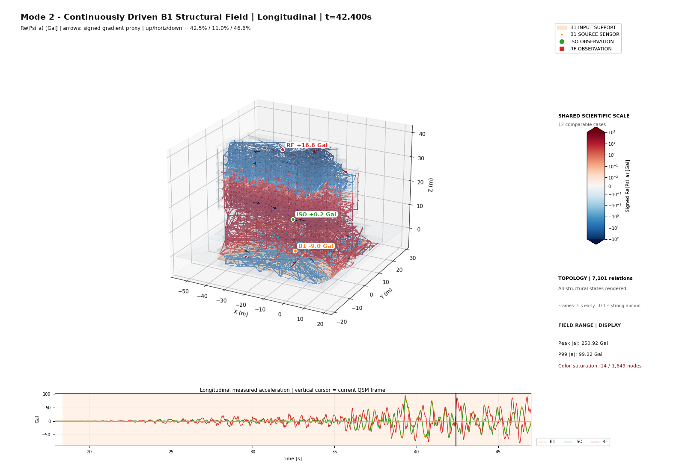


**模式二｜三方向計算與實測波形**

以下三張原始 Structural Response 成果圖依序對照短向、長向與垂直向的 B1、ISO、RF 波形。這些圖是模式二的直接計算成果，原有的比較曲線與時間軸完整保留。閱讀本模式的數值表時，應同時觀察實測與計算的**正負振幅、相位及時間歷程**，避免只由單一相關係數或極值推論整段地震反應。

**短向｜波形**

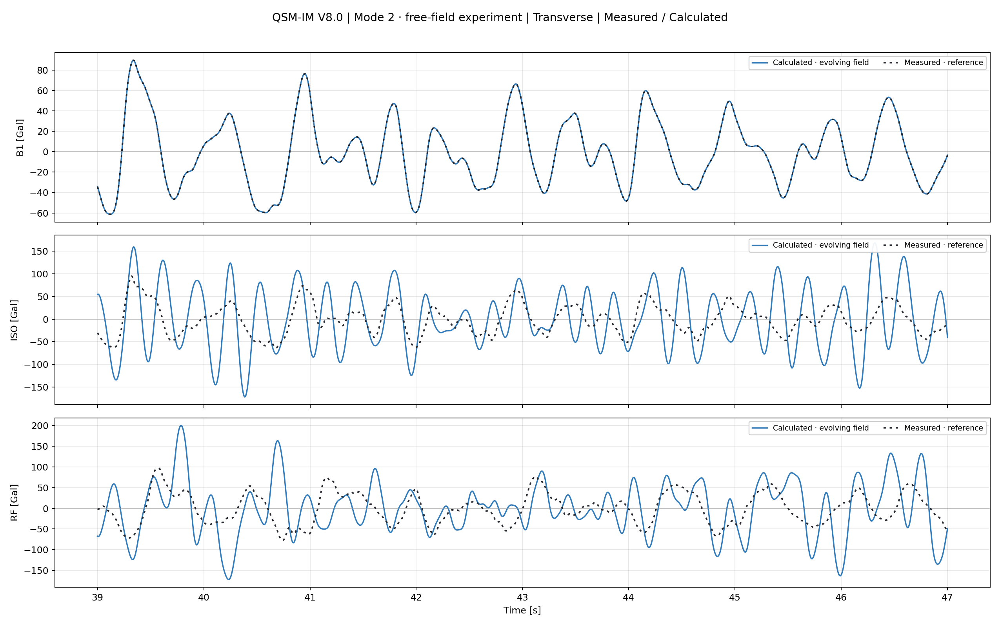

**長向｜波形**

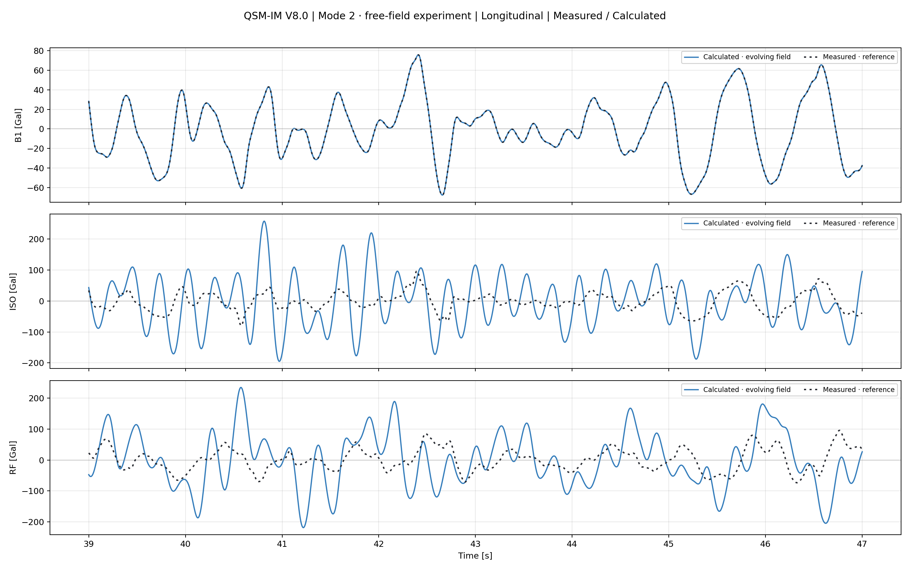

**垂直向｜波形**

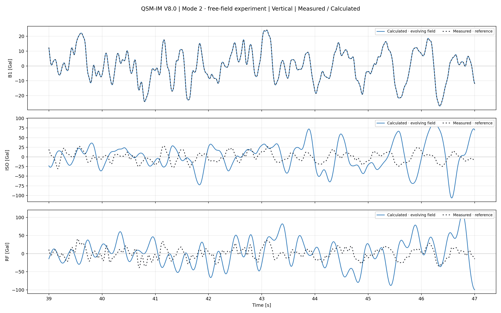

**模式二｜加速度時間趨勢**

這一組較長時間的加速度趨勢圖，上半部顯示 B1／ISO／RF 實測歷時，下半部顯示相應 ISO／RF 計算歷時。圖例中沿用的「ISO OBSERVATION」「RF OBSERVATION」是程式對觀測位置的名稱，下半部曲線仍為求解器計算值；這兩條曲線並不等於 ISO／RF 的真實測值。各方向縱軸尺度應分開閱讀，完整 1,649 節點的空間分布則回到場影格及演化影片。

**短向｜場趨勢**

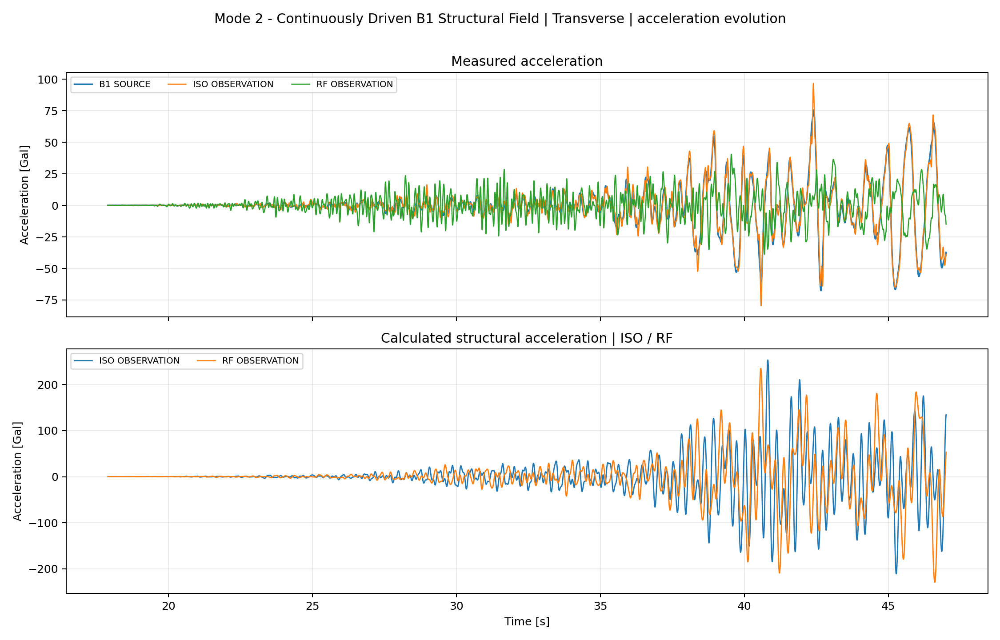

**長向｜場趨勢**

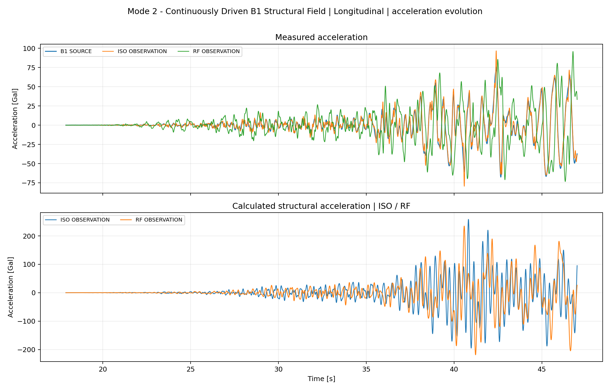

**垂直向｜場趨勢**

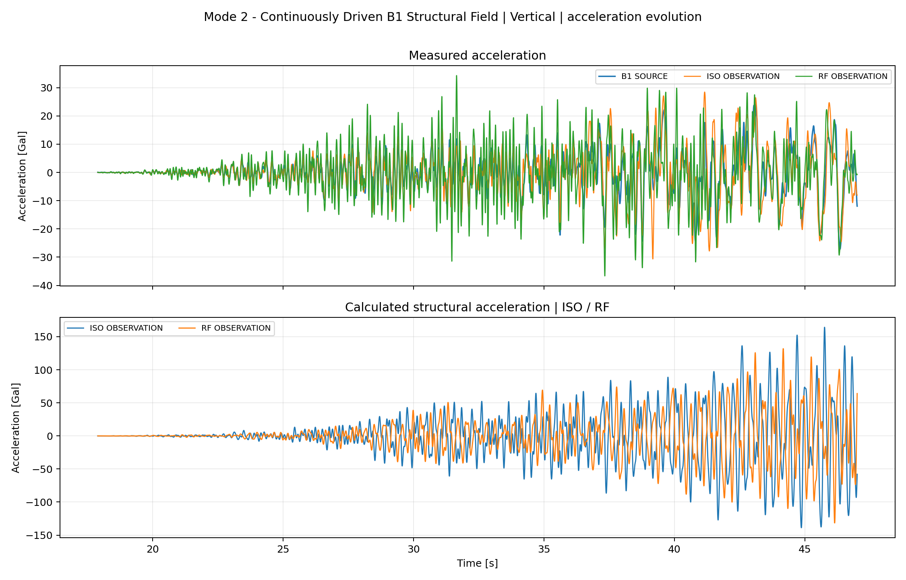

<details>
<summary>模式二｜42.400 秒三方向場影格</summary>

| 方向 | 42.400 秒場影格 |
|:---:|:---:|
| 短向 | 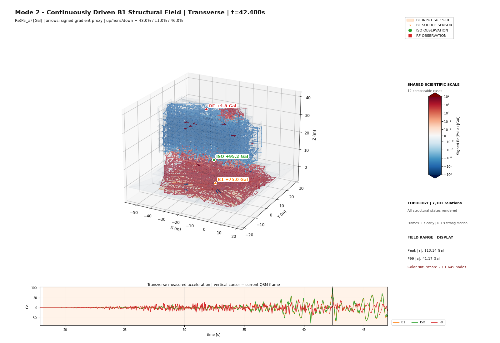 |
| 長向 |  |
| 垂直向 | 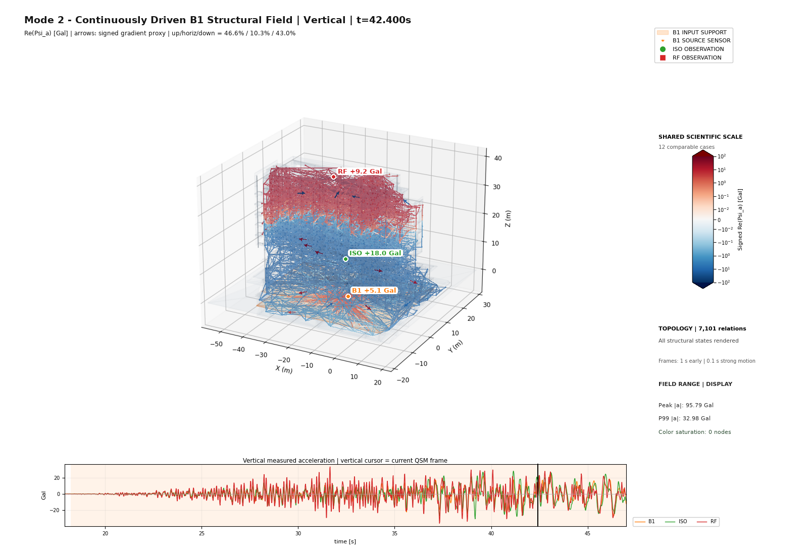 |

</details>

### 模式三｜波形與全場

模式三保留六組 ISO／RF 在觀測導正前後的完整波形，下表直接比較六個 ISO／RF 測點在觀測導正前後的波形，相關係數與均方根誤差均使用相同的 39–47 秒時間範圍，讓觀測介入的效果可以逐一對照。

**表 7｜模式三波形導正**

| 方向與測點 | Prior r | Post r | Prior RMSE | Post RMSE | RMSE 降幅 |
|:---:|:---:|:---:|:---:|:---:|:---:|
| 短向 ISO | 0.297 | **0.691** | 37.01 | **23.96** | 35.3% |
| 短向 RF | 0.737 | **0.870** | 31.94 | **20.58** | 35.6% |
| 長向 ISO | 0.235 | **0.651** | 37.02 | **24.11** | 34.9% |
| 長向 RF | 0.566 | **0.792** | 35.48 | **23.17** | 34.7% |
| 垂直向 ISO | 0.205 | **0.545** | 16.54 | **11.39** | 31.1% |
| 垂直向 RF | 0.591 | **0.833** | 12.65 | **8.32** | 34.2% |

*RMSE 單位 Gal。* 六組測點 Post 的 RMSE 平均降低約 **34.3%**。短向 RF 的 $r=0.870$、長向 RF 由 $0.566$ 提升到 $0.792$，都顯示當步觀測資料的回饋已能把目標波形向實測方向修正。

不過，模式三的實驗目標設定為每次觀測後至少向實測波形導正**半程**。目前凍結成果的實際導正比例中位數，短向 ISO／RF 約 **36.1%／36.5%**、長向約 **35.4%／34.8%**、垂直向約 **33.5%／37.1%**。這份資料仍未達本研究設定的 50% 目標。要同時報告兩項結果：**波形相關性已改善**；**實際半程導正目標仍有差距**。後續導正比例加強時，需要再檢查相位、頻帶及未量測全場的行為，而不僅提高某個測點的單步更新係數。

既然觀測點的波形已經明顯改變，就必須繼續檢查其餘結構節點。下表將觀測前、後的全場最大值、百分位數和均方根放在一起；各數字取自 102 張快照的各自最大統計值，並未限定為同一時刻，因此不能直接相減視為逐時場差。

**表 8｜模式三全場變化**

| 方向 | 場狀態 | 最高絕對加速度（Gal） | 最大 P99（Gal） | 最大均方根（Gal） |
|:---:|:---:|:---:|:---:|:---:|
| 短向 | 觀測前 | 163.41 | 47.50 | 24.29 |
| 短向 | 觀測後 | **163.37** | **47.48** | **24.16** |
| 長向 | 觀測前 | 130.21 | 39.09 | 19.55 |
| 長向 | 觀測後 | **130.17** | **39.08** | **19.47** |
| 垂直向 | 觀測前 | 49.05 | 20.67 | 7.02 |
| 垂直向 | 觀測後 | **49.05** | **20.72** | **7.03** |

這些全場統計是**不同時間快照中的各自最大值**，不能把 Prior 與 Post 的行值誤認為同一個時間點的差分。但它們確實提示一件重要事：即使 ISO／RF 的 Post 波形改善不少，全場的最大值、P99 及 RMS 在當步尺度上並未同比例改變。下一層研究應分析觀測錨點以外的節點差分場、更新後的關係複數狀態，以及這些局部修正經後續 CN 演化累積後造成的空間差異。

這種波形與全場分布的雙重驗證，也能幫助檢查「頻帶修正」是否真的沿 IFC 通道擴展，或只是測點附近的當步微幅修正。

**圖 7｜模式三長向場**

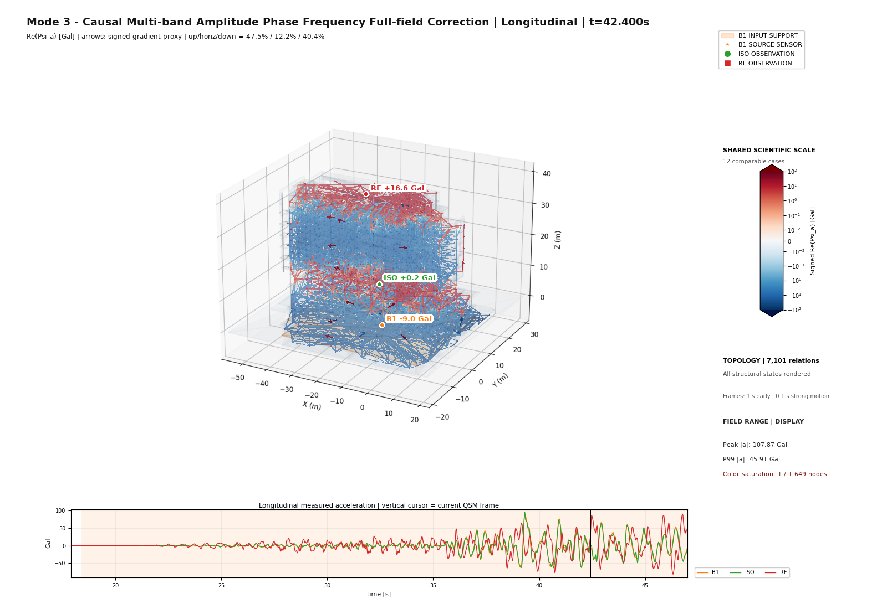


**模式三｜三方向計算與實測波形**

以下三張原始 Structural Response 成果圖依序對照短向、長向與垂直向的 B1、ISO、RF 波形。這些圖是模式三的直接計算成果，原有的比較曲線與時間軸完整保留。閱讀本模式的數值表時，應同時觀察實測與計算的**正負振幅、相位及時間歷程**，避免只由單一相關係數或極值推論整段地震反應。

**短向｜波形**

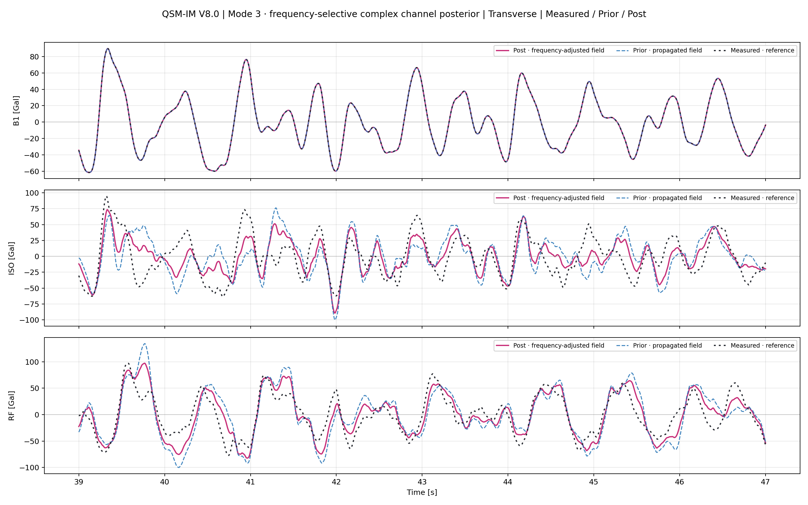

**長向｜波形**

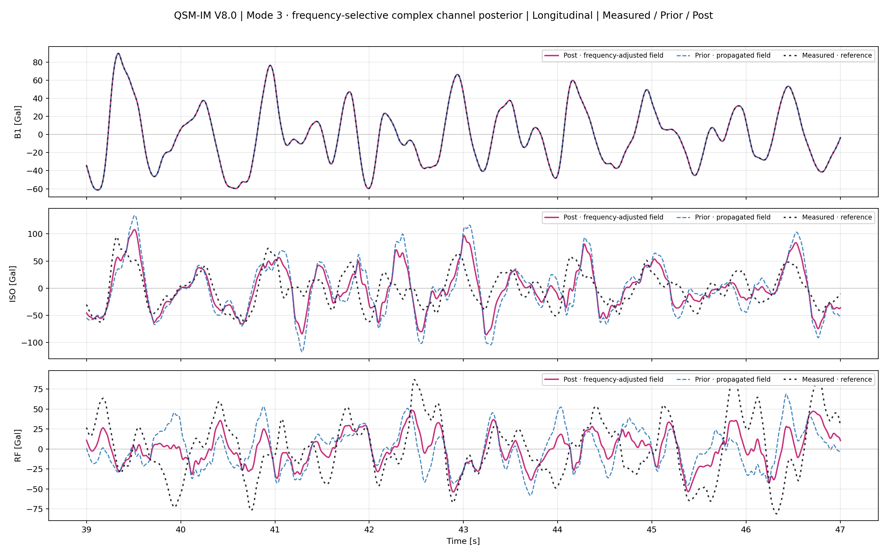

**垂直向｜波形**

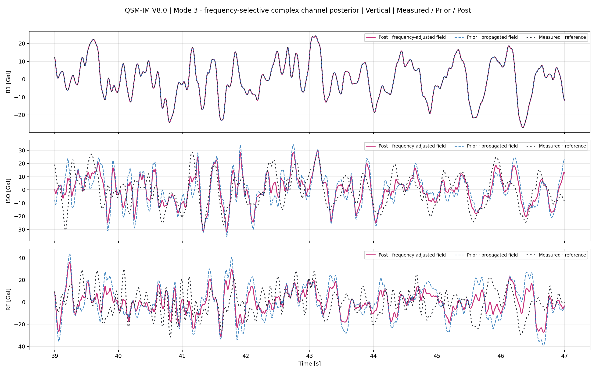

**模式三｜加速度時間趨勢**

模式三的計算歷時應依觀測介入時序區分 Prior 與 Post。以下趨勢圖下半部對應計算歷時的 Prior 讀值；Post 的振幅、相位與頻率導正則需回到上方 Structural Response 圖中的 Measured／Prior／Post 比較及表 7、表 8 的統計。讀取下方曲線時，不能用 Prior 的波形直接代表 Post 導正的成效。

這一組較長時間的加速度趨勢圖，上半部顯示 B1／ISO／RF 實測歷時，下半部顯示相應 ISO／RF 計算歷時。圖例中沿用的「ISO OBSERVATION」「RF OBSERVATION」是程式對觀測位置的名稱，下半部曲線仍為求解器計算值；這兩條曲線並不等於 ISO／RF 的真實測值。各方向縱軸尺度應分開閱讀，完整 1,649 節點的空間分布則回到場影格及演化影片。

**短向｜場趨勢**

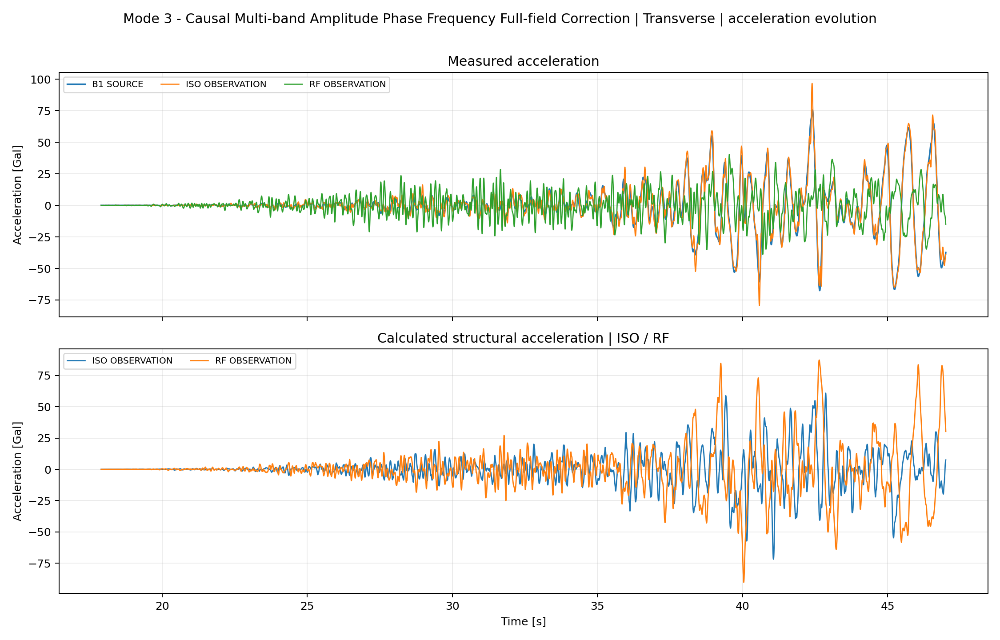

**長向｜場趨勢**

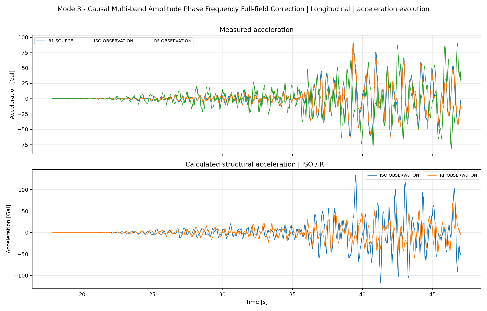

**垂直向｜場趨勢**

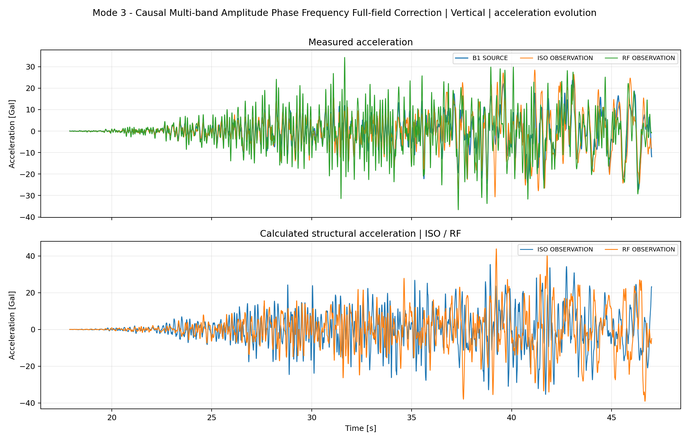

<details>
<summary>模式三｜42.400 秒三方向場影格</summary>

| 方向 | 42.400 秒場影格 |
|:---:|:---:|
| 短向 | 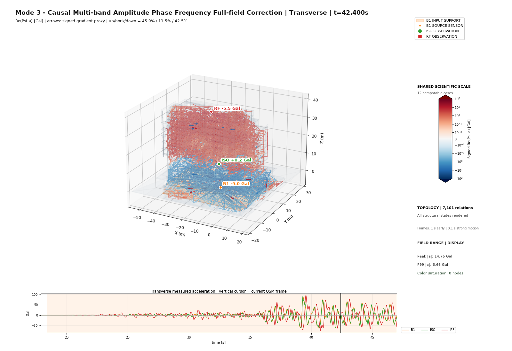 |
| 長向 |  |
| 垂直向 | 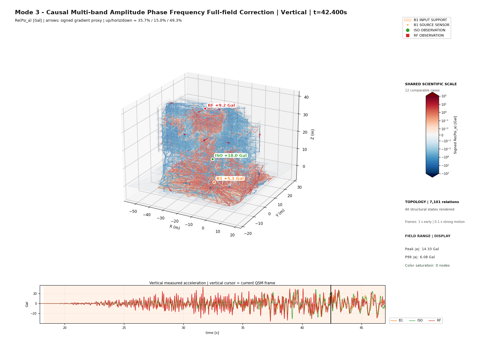 |

</details>

### 模式四｜同步與全場

模式四的 B1／ISO／RF Post 與當步量測一致，對應 ISO／RF 的 Post 相關係數 r = 1.000、均方根誤差 RMSE = 0 Gal。這確認強制同步功能。但要評估 模式四的科學意義，需要直接看三點以外的場。現在完整快照提供 Prior／Post 的統計：

下表沿用模式三的全場統計口徑，呈現三點直接貼合前後的振幅尺度。由於欄內仍為各快照統計的最大值，同一時間的差分與局部高值位置，需要再回到個別時間的結構場影格核對。

**表 9｜模式四全場變化**

| 方向 | 場狀態 | 最高絕對加速度（Gal） | 最大 P99（Gal） | 最大均方根（Gal） |
|:---:|:---:|:---:|:---:|:---:|
| 短向 | 觀測前 | 128.68 | 36.97 | 19.26 |
| 短向 | 觀測後 | **97.13** | **36.97** | **18.98** |
| 長向 | 觀測前 | 133.01 | 37.46 | 16.80 |
| 長向 | 觀測後 | **96.76** | **36.67** | **16.56** |
| 垂直向 | 觀測前 | 46.56 | 24.28 | 8.27 |
| 垂直向 | 觀測後 | **40.49** | **24.28** | **8.24** |

短向最大值從 128.68 Gal 變為 97.13 Gal，長向從 133.01 變為 96.76 Gal，垂直向從 46.56 變為 40.49 Gal。這些全域最大值同樣來自各自時間快照的最大統計，屬於演化分支的比較結果。不同方向的 P99 與 RMS 又呈現不同變化，因此「三點全部貼合」後的整個場並不會以單一倍率變小。模式四的場必須逐時看差分空間、節點與關係更新、未量測位置的高值與下一步 Prior。

**圖 8｜模式四短向場**

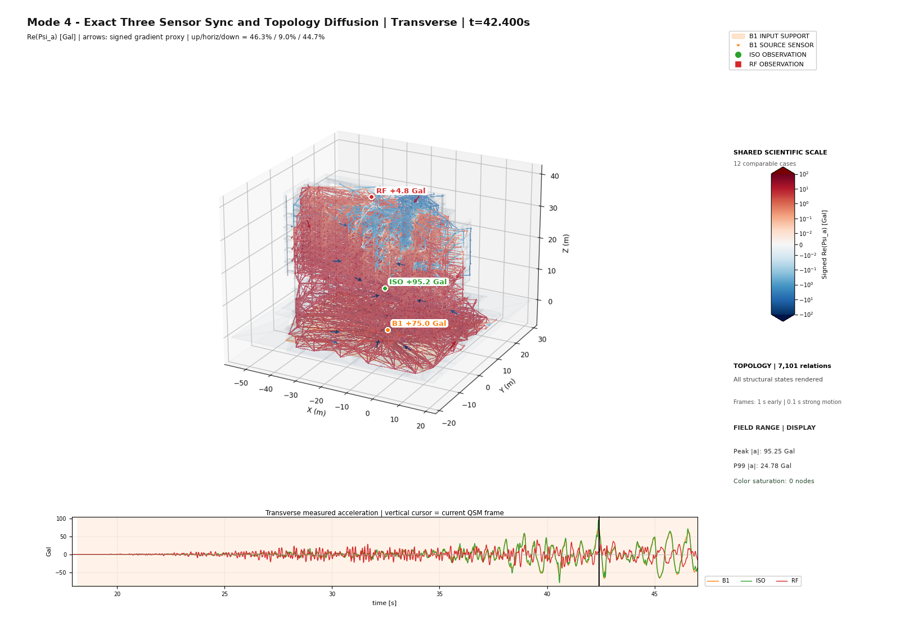


**模式四｜三方向計算與實測波形**

以下三張原始 Structural Response 成果圖依序對照短向、長向與垂直向的 B1、ISO、RF 波形。這些圖是模式四的直接計算成果，原有的比較曲線與時間軸完整保留。閱讀本模式的數值表時，應同時觀察實測與計算的**正負振幅、相位及時間歷程**，避免只由單一相關係數或極值推論整段地震反應。

**短向｜波形**

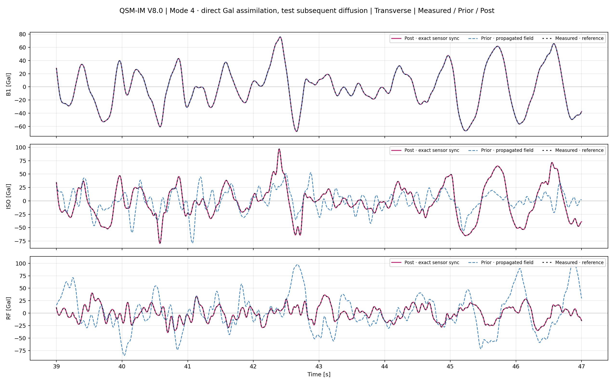

**長向｜波形**

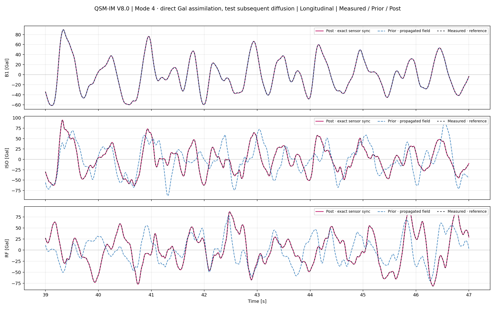

**垂直向｜波形**

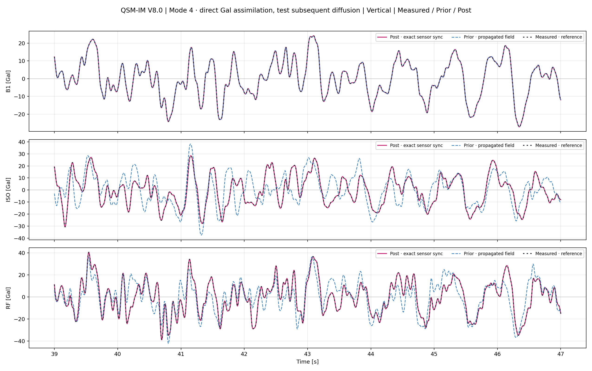

**模式四｜加速度時間趨勢**

模式四的三層觀測錨點在當步 Post 直接同步，因此 Post 與 Measured 的貼合應由上方 Measured／Prior／Post 圖和表 9 所述的同步條件辨識。以下較長時間的計算趨勢顯示觀測介入前的 Prior 演化，當中 ISO／RF 與實測的差異，正是模式四需要施加 Post 更新的依據；不能將這張 Prior 圖解讀成完全同步之後的結果。

這一組較長時間的加速度趨勢圖，上半部顯示 B1／ISO／RF 實測歷時，下半部顯示相應 ISO／RF 計算歷時。圖例中沿用的「ISO OBSERVATION」「RF OBSERVATION」是程式對觀測位置的名稱，下半部曲線仍為求解器計算值；這兩條曲線並不等於 ISO／RF 的真實測值。各方向縱軸尺度應分開閱讀，完整 1,649 節點的空間分布則回到場影格及演化影片。

**短向｜場趨勢**

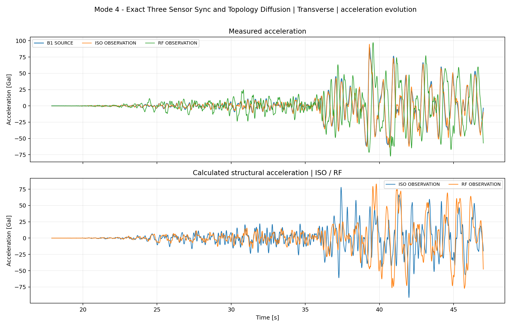

**長向｜場趨勢**

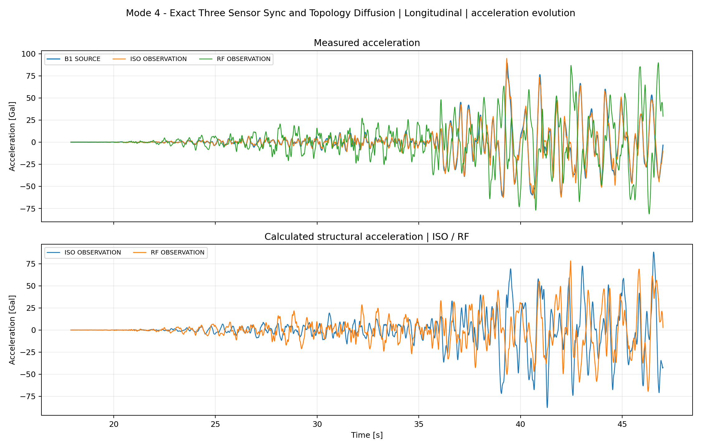

**垂直向｜場趨勢**

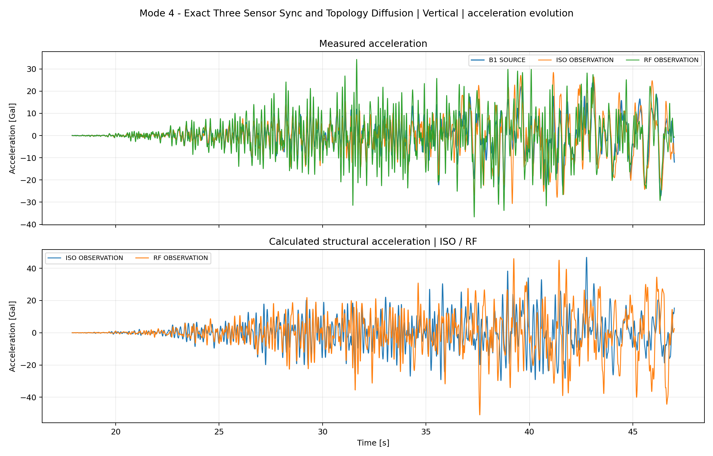

<details>
<summary>模式四｜42.400 秒三方向場影格</summary>

| 方向 | 42.400 秒場影格 |
|:---:|:---:|
| 短向 |  |
| 長向 | 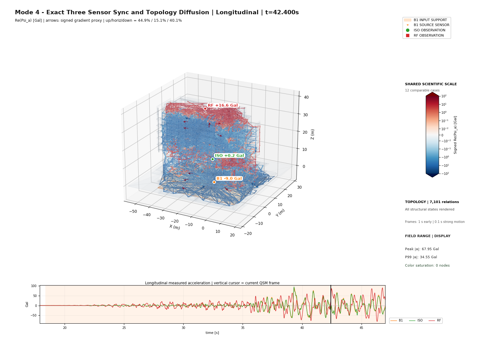 |
| 垂直向 | 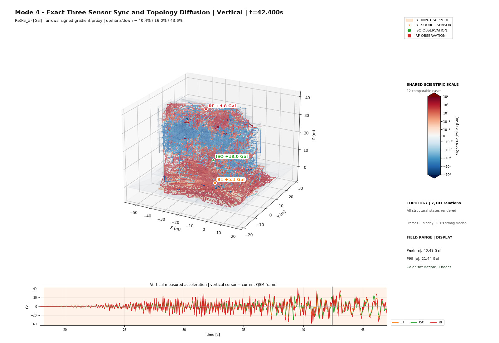 |

</details>

### 四模式連續比較

**圖 9｜全場加速度 P99.5 時間演化摘要**

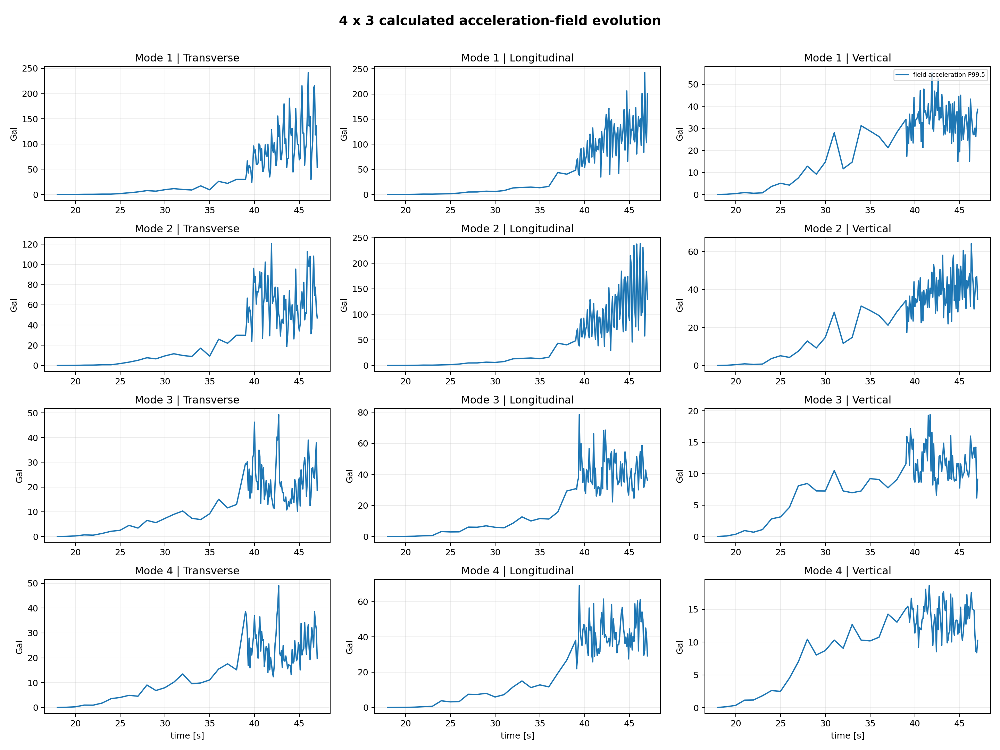

圖中每一條曲線為該時間點全場加速度的 **P99.5** 分位尺度。它與表 5–9 列出的 P99、RMS 及最高絕對加速度採不同的統計口徑，因此用來比較各模式的時間趨勢與持續程度，不能拿圖上的 P99.5 峰值直接替代表格中的其他量。


**圖 10｜四模式 RF 計算與實測波形比較**

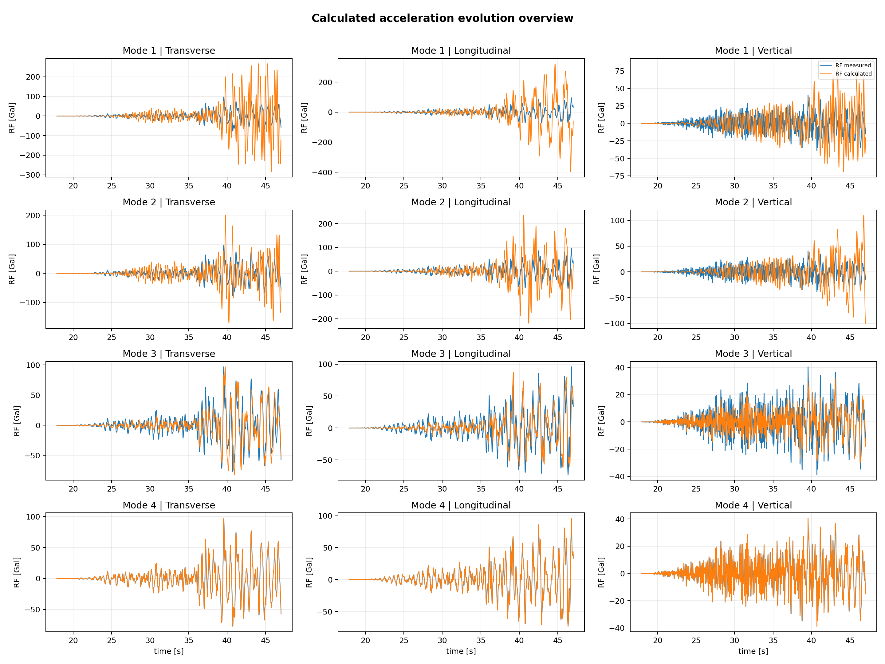

這十二組圖以 RF 作為共同的下游觀測位置，展示同一方向在四種介入條件下的帶正負號加速度波形。模式一、二觀察自由場的計算與量測差異，模式三需連同 Prior／Post 的導正階段閱讀，模式四的觀測錨點同步發生在 Post。圖中相似的曲線形狀，仍需由各模式的實測對照及完整場數據來界定其科學意義。


這一組實驗沿著同一棟建築、同一批三方向資料形成連續的研究路徑。

模式一把**歷史可用資料與外推能力**獨立出來，看單機能否擬似未來一段地震輸入，並在全場先形成具有意義的包絡；模式二讓計算緊貼**當下真實 B1**，檢查關係拓樸自己會顯化多少、在哪些地方集中；模式三再利用逐時 ISO／RF 實測來改變**頻率、相位與振幅響應**，量出 Post 對 Prior 的波形改善，同時追查整場變了多少；模式四施加三點**完全到位的觀測條件**，將重點推往沒有感測器的計算空間。

四種成果由源函數、當步輸入、部分觀測、完整觀測，形成一條可以逐段追蹤的關係場演化實驗。只有把測點波形、全場加速度統計、空間高值、時間事件以及場的複數更新放在一起，才能回答這套方法是否已經顯化這些研究現象。

### 三層觀測的場強度歷時

除帶正負號的加速度外，本次保留 B1、ISO、RF 三個觀測位置的場強度補充診斷。這三張圖分別顯示短向、長向與垂直向在四模式下的 **Field magnitude（Gal²）** 時間變化，可用來觀察不同觀測位置的強度峰值與持續性。圖中三條曲線對應 B1、ISO、RF，沒有展開 IFC 物件的空間密度，因此此處只依圖上物理量及時間歷程分析，物件級分布仍須回到各模式結構場影格。

**圖 D1｜短向三層場強度**

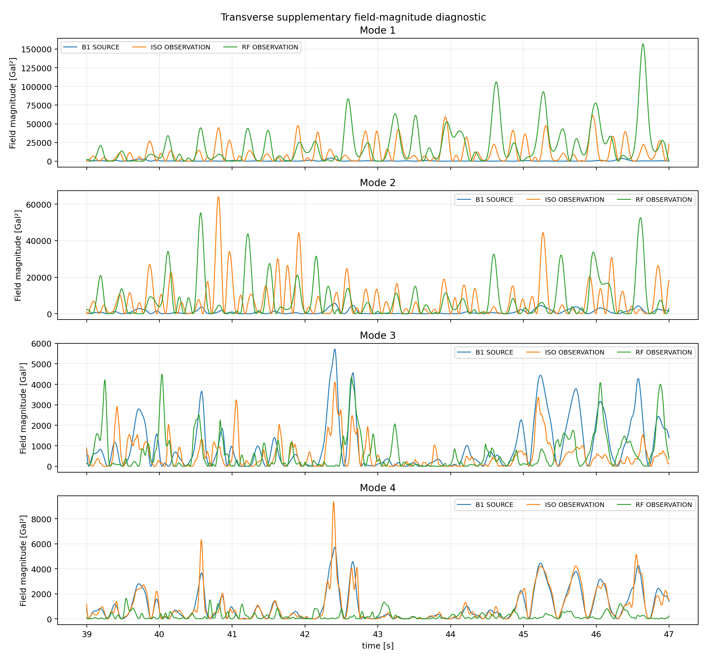

**圖 D2｜長向三層場強度**

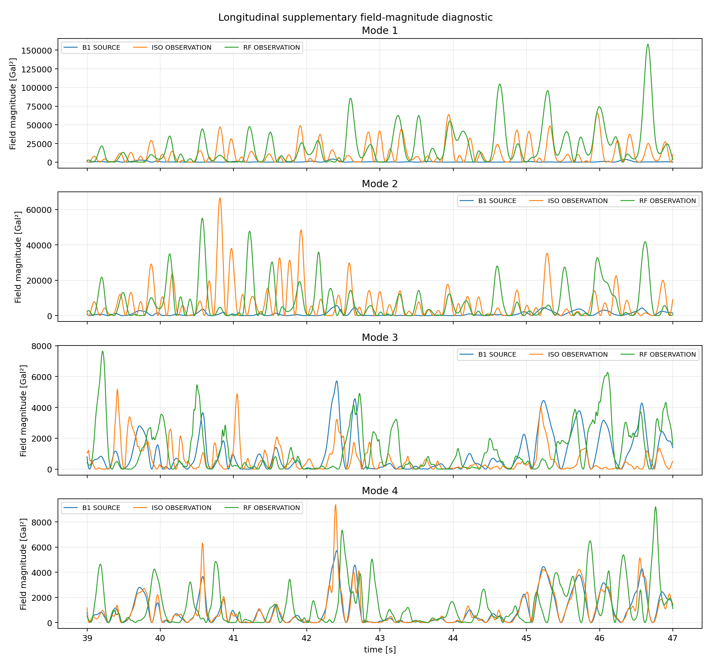

**圖 D3｜垂直向三層場強度**

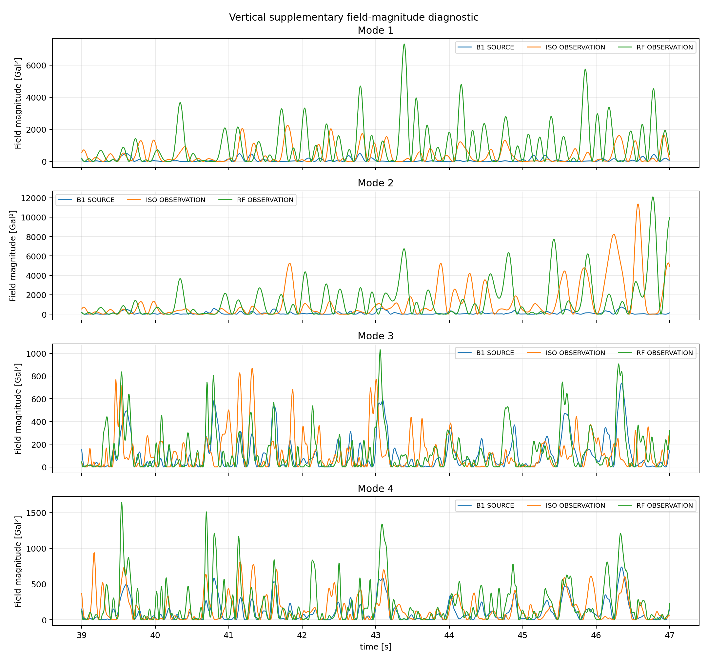

---

**圖 11｜結構場時間軸**

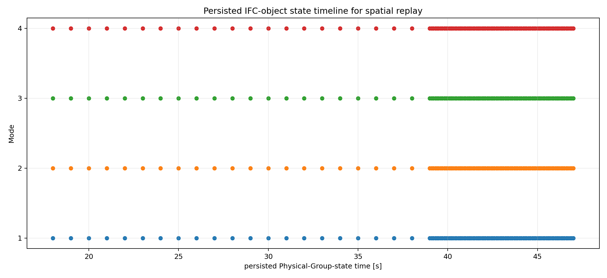


## 七、從三方向動畫，走向結構場的趨勢推演

前面依模式一至模式四討論了來源外推、真實 B1 持續輸入、部分觀測導正與三點直接同步，也逐一檢查測點相關性和未量測空間的加速度分布。這些表格可以看到數字，卻無法獨自呈現場在相鄰時刻如何移動。因此，這一章回到原來已經輸出的三支四模式同步影片，讓讀者沿時間閱讀整個結構通道網路的反應。

三支影片都從建築三維拓樸開始，接著呈現三層級量測概覽，再進入同時間的四模式比較。短向、長向與垂直向各保留一支完整 MP4；透過高解析播放器可以在同一網頁切換觀看，也可以直接開啟原影片逐時比較四種場。

### 短向｜ISO 與 RF

表 3 的實測數值顯示，短向 ISO 峰值為 94.72 Gal，RF 為 97.13 Gal。閱讀短向影片時，可先比較四模式在 ISO／RF 一帶的空間顯化，再注意自由場與觀測介入後的場分布有何差異。這個方向亦保留 42–43 秒局部事件作為後續檢查重點。

**影片 1｜短向四模式動畫**

[短向四模式高解析播放器](viewer.html#transverse)　｜　[開啟短向完整 MP4](videos/CERB_transverse_four_modes.mp4)

### 長向｜自由場與導正

長向的自由場局部最高值，以及模式三長向 RF 相關係數由 0.566 改善至 0.792，是兩項不同尺度的結果。前者在整個空間場內尋找高值位置，後者則檢查觀測回饋對單一測點波形的作用。影片讓這兩個問題回到同一段時間內閱讀，也提醒我們波形修正幅度不必然等於整個場同步改變的幅度。

**影片 2｜長向四模式動畫**

[長向四模式高解析播放器](viewer.html#longitudinal)　｜　[開啟長向完整 MP4](videos/CERB_longitudinal_four_modes.mp4)

### 垂直向｜第三套場

垂直向的實測加速度尺度與兩個水平向不同，場內也存在獨立的波形及局部響應。保留這一套方向場，有助於檢查同一結構拓樸與觀測導正方式，在不同方向是否仍有一致的運作邏輯；但不能因為垂直向尺度較小，就把不同方向的高值直接視為相同的物理機制。

**影片 3｜垂直向四模式動畫**

[垂直向四模式高解析播放器](viewer.html#vertical)　｜　[開啟垂直向完整 MP4](videos/CERB_vertical_four_modes.mp4)

### 結構通道與場趨勢

這次實作讓我對後續研究目標有了更具體的想法。將 BIM 幾何轉成灑點佔據、再收束為節點與關係之後，**結構圖可以代表地震波進入建築時可供演化的結構通道**。每個節點可以視為承接狀態的計算單元，每條關係則保存通道間如何交換、回饋與共同變化。當波從 B1 進入，整張圖隨時間改變；如果能持續比較既有場、當步新輸入及觀測回饋，就有機會從一連串空間狀態中研究場的趨勢。

未來若進一步採用量子運算，可以研究把通道基底編碼成量子邏輯位元，讓節點關係進入相應的耦合運算。目前的成果已在傳統電腦上展現節點–關係場演化與回饋的操作可能性，量子編碼仍是後續研究構想。

從實際使用情境來看，我希望這套方法將來能協助研究人員在有限觀測下推演整體結構反應的**趨勢、局部高值可能出現的位置，以及觀測資料加入後對場的修正**。不過，這次只有 B1、ISO、RF 三個觀測層級，未量測位置仍缺乏足夠的直接驗證。未來需要更多測點、保留測點的獨立測試，或其他可對照的物理模型，逐步確定哪些區域可以合理推演、哪些仍只能當成探索性的計算結果。

因此，這個研究範例已經能將地震輸入、觀測回饋及結構通道的全場演化連接起來。它已能讓輸入、觀測與整個場相互作用；至於能否轉成可靠的預警或結構監測應用，還需要用更完整的觀測證據釐清驗證邊界。

## 八、十條實作失效鏈

這份研究是從多次實際計算、回查數值、修正演算法與完整案例重跑逐漸形成的。科學把關要求的來源是實作中的失效證據；它們直接影響 QSM 的物理意義、演算法可辨識性與最後能夠成立的研究結論，因此應在主文交代，而非只有附上一串 科學驗收條件編號。

### 1. 灑點規模與自由度

一開始希望把完整的 10 cm 空間觀察直接帶入波傳演化，計算尺度迅速膨脹。歷史版本曾出現約千萬節點的直接圖求解，過密或極短的邊造成巨大圖度量、Chebyshev 展開階數失控與矩陣分解的記憶體障礙。研究後來才明確分成空間佔據灑點、IFC 計算群組及結構關係三層。這才可以同時保留約 950 萬有效觀測點的空間證據，以及 1,649 個計算通道與 7,101 條關係的可求解模型。

因此，**灑點如何歸屬、群組如何收束、關係如何建立與求解的狀態數是多少**，都是科學模型定義的一部分。不能只在文章裡留一句「建築資訊模型前處理」。

### 2. 幾何、來源與軸向

模型資料與幾何核心的尺度問題曾讓空間位置與樓層辨識不可靠；將整片 B1 當成單一受迫對象則抹除了來源周圍的局部關係。早期 B1 邊界又曾把輸入來源與場的自由預測混在一起，三軸出現反向相關與過度放大的單步響應。改成單一局部樓板物件 錨點，並對 帶正負號的加速度、B1 感測位置、ISO 隔震界面上下側及 RF 映射逐一核查，都是為了讓來源及觀察層級在物理上站得住腳。

### 3. 時間校正未進入演化

歷史 V6.8／V7.0 工作稿曾能計算 B1–RF 首波時間差，並產生 relation-time 校正表，但相應參數未真正控制四模式 B-Dirac／CN 的演化尺度；後續單次首次越閾波前的延伸搜尋也曾把弱訊號誤納為主校正，造成演化時鐘失真。這次以十組波包的 B1→ISO／B1→RF 雙路徑候選取代單一首次波前判定。將參數從 1 改為 10，求解複數場仍完全一致，正好揭露這個介面失效。後續研究才把校正與求解器共用的傳播時鐘重新連接，並留下 RF 與 ISO 的觀測差異供對照。

這件事要求我們持續分開驗證「有一個校正數字」與「校正確實改變傳播，且波前對齊實測」兩個環節。波由 B1 到 ISO 再到 RF 的相位及到達差，必須能回到演化算子本身。

### 4. 演化算子遭替換

V6.9 曾用另一套離散雙向散射更新取代原本連續時間的 B-Dirac／CN，實測與計算的到達時間尺度嚴重偏離，模式一切換源時出現不連續，模式四的相關性也大幅退步。這說明這個研究真正要保存的核心，是**零對角 B-Dirac 由關係耦合顯化波形，再由 CN 連續推進完整複數場**。新的通道模型與觀測回饋只能建立在可對照的算子定義上，不能在版本進展中悄悄把研究變成另一套傳播器。

### 5. 模式一來源外推

當 模式一在 40 秒突然停止來源、產生跳變，或外推函數被預設衰減快速壓平時，原本要研究的自由震盪、全場包絡及可能預警訊號就失去可檢查性。這也是為什麼現在需要單獨保存 B1 函數訓練、截止連續性、外推頻帶及 RMS，並再把外推場的局部高值與事後實測比較。**是否足夠預警**必須以事件提前量與誤報衡量，目前仍是尚待建立的測試，不以全場極值很大直接宣稱成功。

### 6. 模式二下游振幅消失

模式二的測試條件很簡單：B1 在每一步都有真實地震加速度輸入，ISO 與 RF 不接受觀測貼值，接下來要看通道關係自己能否讓波在兩個下游位置顯化。早期實作曾出現 **B1 訊號仍在，ISO／RF 卻幾乎沒有可辨識震盪振幅** 的結果。若只驗證來源是否成功讀入，程式仍可能顯示正常；但這個模式要研究的波動傳遞及場的分布，實際上沒有成立。

這條失效與模式一必須分開。模式一的核心風險出在**以歷史資料擬似接下來的輸入函數**，包括切換點跳變、外推震盪消失及包絡失效；模式二使用當步真實 B1，所以問題應沿著 **局部來源如何進入節點－關係場、耦合是否持續傳遞、ISO／RF 是否對應正確的計算錨點、顯化量是否保有正負振幅與時間變化** 檢查。過去的歷程確有下游無有效振幅這個現象；單靠該現象還不能唯一指認是哪一行運算造成，因此把上述環節列為逐項檢驗的失效鏈。

目前模式二已能在 ISO／RF 產生可比較波形，也能形成全場局部高值，但兩個下游觀測點與實測的相關性仍偏低。這說明 **振幅能夠顯化、波形能否吻合、全場高值是否合理** 必須分三道科學檢查。不能因為已經看見波，就省略傳播時鐘、測點對照及空間場驗證。

### 7. 模式三波形導正失效

V7.6 以前的模式三多次發生 Prior／Post 幾乎重疊，或振幅被錯誤放大兩三倍的情況。有些實作計算了頻率創新量，卻只將其記入診斷；有些將多頻帶複數差異壓縮為單一局部實數修正，失去了頻帶選擇性的實際波形效果。後續把頻帶創新、當步 Post 節點與關係更新、以及下一步 CN 延續連接起來，才得到這次可以量化的波形改善。

現在又往下一層發現，**六組觀測的相關性改善不代表半程導正目標已達成**，且當步全場 Prior／Post 分布差異仍有限。模式三的科學驗收要同時核對波形導正比例、頻帶相位、場的空間修正與之後的時間累積。

### 8. 模式四測點與全場

模式四當步 Post 與三點實測完全一致，可以測出程式是否確實執行貼合。之前曾發生錯把已知實測值寫到計算成果摘要、讓模型看起來非常漂亮的風險。因此本文一定要同時列 模式四Prior、Post 及未測節點的全場分布，並明確說明錨點相關係數 1.000 的意義。真正的科學問題是完全同步的觀測介入，對原本自由場及未測空間造成什麼改變。

### 9. 自由場局部高值

模式一／二 的局部高值一度遠高於 B1、ISO、RF 的量測尺度；不同版本也曾出現十倍左右的異常放大。這些數字的形成可能涉及高連通來源、相位累積、輸入驅動或算子尺度。研究應保存完整具有正負方向的加速度與複數關係場，在 IFC 高值節點附近檢查其鄰接、時間持續性與頻率成分，並保留有界控制分支與無裁切主分支。**高值的存在是要研究的場現象，其合理性須由額外證據支持**。

### 10. 驗收證據的分層

過去多次出現測試宣告通過、卻在本機完整 Replay、診斷封裝或實際操作才發現失效的情況。軟體輸出、版本命名與影片是交付工程的檢查事項，另置於技術發布紀錄；在科學上，則堅持將**求解器一致性、因果性、單位波時間、四模式研究目的、觀測點相關性、全場時空分布，以及未測空間的獨立驗證**分成不同 Gate。這樣才能避免把一個層級的 PASS 移作另一個層級的結論。

這十條失效鏈也顯示，這項研究的科學成果由多層證據逐步構成。**本文最後的 30 項原則，是針對上述問題建立的可重現科學要求。** 它們不包括影片解析度、ZIP 容量、版本名稱或選單外觀等交付要求。

---

## 九、三十項科學把關要求

以下固定為 **30 項科學要求**，依照三方向與三樓層觀測、空間灑點與拓樸、零對角 B-Dirac 關係演化、四模式目的以及實測與全場科學驗證整理。影片、選單、封裝及檔名屬工程交付條件，另外依版本管控。歷史 Science Lock 保留原有條文與版本關係供追溯。

### A. 建築資訊模型、通道與拓樸的科學完整性

1. **幾何及單位一致性。** IFC 樓層、邊界表示幾何、0.10 m 空間格點與感測位置須使用一致且可查證的空間尺度，幾何轉換要有核對紀錄。
2. **灑點的實體佔據與可追溯性。** 保留佔據測試、全域格點去重、多重 IFC 成員歸屬及原始 IFC 身分；抽樣與快取不得悄悄改變拓樸。
3. **觀測格點與計算狀態區分。** 約 950 萬點的觀測場與 1,649 個結構計算節點承擔不同角色；灑點集合不能被默認等於計算自由度。
4. **關係產生機制須可追溯。** 0.15 m 鄰域、共佔據與不同關係類型有可查證的建立依據；關係總數、連通分量、跨樓層關係與節點度數應可獨立核對。
5. **權重與時間物理量分離。**  $W=1/d_{\mathrm{eff}}$ 的有效格點關係權重，不直接換算成材料波速或真實行進時間；時鐘校正另行驗證。
6. **來源錨點具有空間實在性。** B1 輸入只作用於經原 IFC 與監測位置支持的局部計算群組，保留整個地下層的結構差異。
7. **三方向與三層級場的物理對照。** B1／ISO／RF 的 CH、軸向符號、樓層及隔震界面上下側須核對；同一拓樸分別建立短向、長向與垂直向的方向場，保留 B1→ISO、ISO→RF 的振幅／相位／頻率差異。

### B. 求解器、演化及因果性

8. **B-Dirac 的關係主導與零對角區塊。** Hamiltonian 的兩個對角區塊維持為零，透過節點–關係入射矩陣耦合更新通道及關係複數場，並驗證 Hermitian、CN 演化、數值有限性及適用的自由演化守恆條件。
9. **原始 Gal 有正負且顯示與計算分離。** 顯示用的色階飽和不能裁切原始具有正負方向的加速度，也不能破壞複數場的計算資料。
10. **B1 是可追溯的受迫來源。** 模式二–四 只使用截至當步取得的 B1；模式一僅以截止前 B1 訓練輸入函數，之後由該函數外推。
11. **波包時間尺度確實作用於求解器。** 三軸 B1→ISO、B1→RF 十組峰谷波包的候選延遲、中位數及 MAD 應檢驗其在同一 CN 算子中的實際效應；ISO／RF 匹配歧義與量測時間尺度分開報告。
12. **觀測介入不得讀取未來資訊。** 對資料尾端擾動的因果前綴測試，不得改寫較早時間步的 Prior／Post。
13. **輸入、自由演化與觀測回饋分開記帳。** 儲存來源、Prior、Post、關係更新與對照分支，讓每一步的變化可追溯。
14. **時間步長與事件測試。** 內部 CN 子步、0.005 s 歷時及局部強響應區間須有收斂檢查；不能用單一漂亮畫面取代時序測試。

### C. 四模式與頻帶介面

15. **模式一自主外推及預警實驗。** 以歷史 B1 擬合函數持續驅動獨立場，檢驗截止點連續性、頻帶、震盪與全場包絡；以事後實測另行驗證包絡覆蓋率、提前量、漏報及誤報，未完成者標 尚待驗證。
16. **模式二持續 B1 的原生關係演化。** 不以 ISO／RF 實測修改當步場；必須檢查兩個下游位置確實由關係演化形成非平坦、可追溯的振幅及時間變化，並分別檢驗其與實測的相關性。保留通道間放大、干涉、反射、雙向交換、回返與自由場局部高值。
17. **模式三半程導正及全場變化實驗。** 每步先保存觀測前完整 Prior，再依當下及過去 ISO／RF 的振幅、相位與頻率形成 Post；獨立核對實際波形修正比例是否至少半程、六組相關性與 RMSE，以及未測節點和後續關係更新；這批計算成果的半程目標尚未達標。
18. **頻帶創新量必須實際參與導正。** 不同頻帶的複數資訊不能被無記帳地壓成全域單一倍率；頻率及相位差須能作用於當步波形與後續耦合。
19. **模式三觀測回饋進入結構關係。** Post 對未測節點的傳播與下一步 CN 需能追溯至結構通道及其關係狀態；不得只在兩個錨點畫不同顏色。
20. **模式四三層同步後的重建目的。** B1／ISO／RF 當步具有正負方向的加速度 貼合觀測錨點，研究未測節點的全場分布、局部高值、通道交換及下一步 Prior；與模式三的部分調頻導正分別驗證。
21. **自然分支與有界對照分離。** 主實驗保留未裁切的全場高值；若使用振幅投影或上界，須標明為外加約束，並保留投影前後對照。
22. **ISO 阻尼介面的作用保留尚待驗證。** 頻帶選擇、相位變化、反射、回返、振幅局部放大及 RF 反應變化須能分別檢驗；不能僅由場振幅收束推導阻尼器實際耗散功。

### D. 實測、全場與科學結果

23. **三軸三層級的真實歷時核對。** 加速度正負值（Gal）、軸向方向、時間間隔、峰值、相位與頻率比較都保留原始對齊，不人工平移時間軸提高相關性。
24. **四模式完整相關性。** 模式一／二 保留 Calculated 與 Measured；模式三／四 分開保存 Prior、Post 及其 Pearson r、RMSE、MAE、峰值，主震與完整演化區間各自評估。
25. **全場加速度分布必須可追查。** 對全部 1,649 節點，保存正負極值、RMS、P50／P95／P99／P99.9、高值比例、前 20 節點、IFC 身分及發生時間。
26. **不可用採樣快照極值冒充逐步全歷時極值。** 102 張持久化快照與所有 5,821 個求解時間步的統計範圍需要明確區分。
27. **重要局部事件單獨驗證。** 包括短向 42–43 秒 ISO 高峰及 RF 對應衰減、長向 ISO／RF 之相位與波形，避免平均值抹除短時現象。
28. **測點改善與未測空間驗證分開。** 模式三Post 相關性或 RMSE 改善只能支持觀測輔助重建；未觀測全場須另與獨立感測器、合適結構基準或留出資料比對。
29. **物理量意義明確。** 複數場範數、Gal²、關係交換代理與真正機械能、速度、功率、阻尼器耗散功各自有不同的證據需求。
30. **數值與物理驗收獨立。** 程式能執行、單位測試通過、真實測點符合、未量測位置驗證，各自留下通過／未通過／尚待驗證的紀錄；負向測試與消融試驗不得省略。

---

## 十、資料來源與引用

本研究使用的加速度資料由**國家地震工程研究中心**提供；建築資訊模型由<strong>臺大土木工程資訊模擬與管理研究中心（台大BIM中心）</strong>提供。以上資料來源在本文致謝中明確列出。研究團隊自行開發的量子結構力學演算、四模式分析及其衍生的數值成果，與來源單位提供的資料分別記錄。

### 引用文獻

［1］游忠翰、汪向榮、彭聖凱、林旺春、楊卓諺、曾育凡、陳禧耘、柯宗滕、柯鎮洋、張國鎮（2024）。〈隔震建築於 0403 花蓮地震之性能表現〉。《土木水利》，51(2B)，52–66。DOI：[10.6653/MoCICHE.202405_51(2B).0005](https://doi.org/10.6653/MoCICHE.202405_51(2B).0005)。

［2］Kuo, H.-J. (2026). *Quantum Structural Mechanics: A Macroscopic Framework for Structural Power Evolution and Experimental Observation*. ResearchGate Preprint. DOI：[10.13140/RG.2.2.17158.95046](https://doi.org/10.13140/RG.2.2.17158.95046)。[研究頁面](https://www.researchgate.net/publication/415545886_Quantum_Structural_Mechanics_A_Macroscopic_Framework_for_Structural_Power_Evolution_and_Experimental_Observation)。

第一篇提供 CERB 隔震建築的公開背景、阻尼配置與既有監測研究；第二篇提供量子結構力學的宏觀動力與功率演化研究框架。本文將其作為兩項明確的引文基礎，沒有將技術報告的延伸參考書目整批移入本工作稿。

### 公開範圍與研究成果

本文件為僅供學術團隊交流的工作草稿，請勿直接引用或公開轉載。本文整理了建築模型建構、三方向三層級觀測、四種演化模式、數值成果及十條實作失效鏈，仍須經學術審閱與確認。實際公開的圖片與影片依授權狀況逐項審查；原始實測加速度、完整試驗歷時、來源 IFC 模型、完整節點／關係複數場及求解器原始程式留在研究工作區。本展示包放入已渲染的圖片與影片，是否公開發布仍由研究者依授權範圍決定。

---

## 附錄｜V8.0 圖像成果對照

這份公開展示從 V8.0 診斷影像中選取可直接閱讀的成果。三方向與四模式的 **12 張 Structural Response 波形、12 張加速度時間趨勢**已放在第六章數值表後方直接顯示，並保留各模式 42.400 秒三方向場影格及三支完整影片。第一章保留兩張相對狀態向量圖，第六章另保留三方向 B1、ISO、RF 場強度歷時；來源資料仍以原始研究工作區保存。

時間差分診斷另外列在下表，供檢查個別模式的短時變化，不將它作為四模式科學成效的唯一判定依據。以下只提供既有診斷圖像的連結，不公開相應 CSV 數列，也不把差分訊號誤當成原始加速度場的整體物理驗證。

**表 A1｜時序補充圖**

| 模式 | 短向 | 長向 | 垂直向 |
|:---:|:---:|:---:|:---:|
| 1 | [查看圖像](figures/Mode_1_transverse_temporal_change_diagnostic.png) | [查看圖像](figures/Mode_1_longitudinal_temporal_change_diagnostic.png) | [查看圖像](figures/Mode_1_vertical_temporal_change_diagnostic.png) |
| 2 | [查看圖像](figures/Mode_2_transverse_temporal_change_diagnostic.png) | [查看圖像](figures/Mode_2_longitudinal_temporal_change_diagnostic.png) | [查看圖像](figures/Mode_2_vertical_temporal_change_diagnostic.png) |
| 3 | [查看圖像](figures/Mode_3_transverse_temporal_change_diagnostic.png) | [查看圖像](figures/Mode_3_longitudinal_temporal_change_diagnostic.png) | [查看圖像](figures/Mode_3_vertical_temporal_change_diagnostic.png) |
| 4 | [查看圖像](figures/Mode_4_transverse_temporal_change_diagnostic.png) | [查看圖像](figures/Mode_4_longitudinal_temporal_change_diagnostic.png) | [查看圖像](figures/Mode_4_vertical_temporal_change_diagnostic.png) |

原始診斷檔另包含四模式、三方向、各 **102 個持久化時間快照**的空間場影格，以及每個模式與方向的一張三層級加速度時間趨勢圖。這次公開以代表時刻的場影格、三層級時間趨勢圖及三支四模式動畫呈現其時間與空間變化，未將逾千張逐時影格逐張塞進 README，也沒有把研究原始資料或求解程式一起公開。這樣的內容選擇是為了讓讀者可以沿著時間與方向閱讀演化，並清楚區分原有輸出、公開圖像與仍保留的計算資料。
