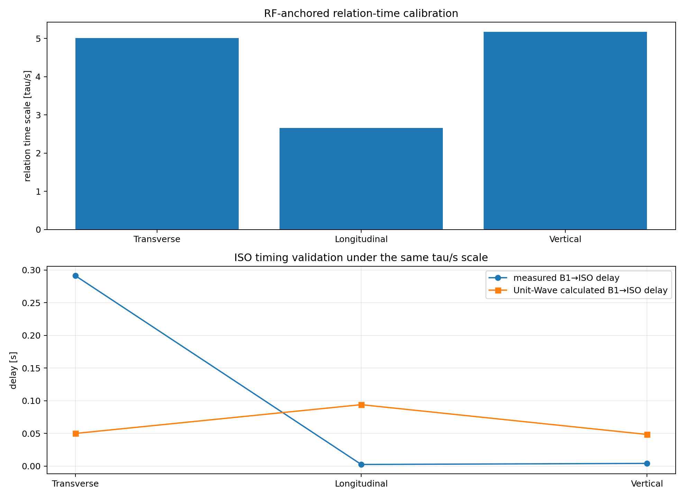
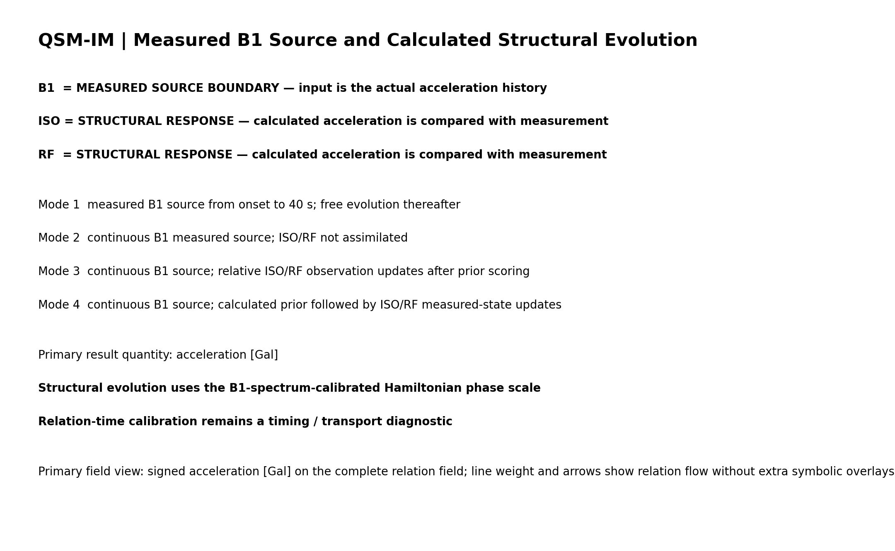

# CERB 2024 Hualien Earthquake QSM Demo

## 運用量子結構力學方法描述台大土木研究大樓2024花蓮地震動態過程

**工作草稿｜研究成果凍結版本 V8.0｜GitHub 圖文整合版**

> **學術交流聲明**　本文件為工作草稿，**僅供學術團隊之間交流，請勿直接引用、轉載或作為正式研究結論引用**。文中的模型解讀、數值比較及圖像仍在整理與驗證中。如需使用研究資料或衍生成果，請先取得相應資料來源及研究成果權利人的同意。

本研究以臺灣大學土木研究大樓（Civil Engineering Research Building, CERB）於 2024 年花蓮地震的結構動態為案例，使用量子結構力學（Quantum Structural Mechanics, QSM）來研究加速度如何從地下層進入、經由結構通道及中間隔震界面傳遞，並在不同觀測條件下形成完整的加速度場。研究方法的理論來源見［2］；建築隔震與監測背景參見［1］。這次使用的凍結計算成果版本為 **V8.0**。

**研究資料來源**　地震加速度資料由國家地震工程研究中心提供；建築資訊模型由**臺大土木工程資訊模擬與管理研究中心（台大BIM中心）**提供。本文以三個觀測層級、三個方向的量測為依據，從建築模型建構、關係場與觀測輸入，依序檢視四種演化模式及未量測位置的場域變化。

**物理範圍**　QSM 理論關注結構功率（Power）及其演化。本次實作的實測基礎為**加速度**，主要呈現帶正負號的加速度歷時及關係場演算結果，尚未建立可直接計算結構功率所需的完整速度、受力與質量狀態。因此本文不將 Gal、加速度平方、複數場範數或關係交換代理量解讀為機械功率、耗散功或構件損傷。

**展示素材**　本資料夾直接使用 V8.0 Replay 已產生的圖、表及三支影片。圖片及影片保留原始成果畫面；README 的研究表格提供彙整數值。本資料夾不含求解器、建築資訊模型、0.005 秒原始歷時或可完整重現數值演算的資料包。

---

## 一、案例背景與三方向三層級觀測設計

CERB 是一棟中間樓層隔震建築。公開技術報告［1］記載，隔震層位於二樓與上部樓層的交界，設有 19 組鉛心橡膠支承墊，以及長向兩組、短向四組液態黏性阻尼器；建築設有多樓層加速度與隔震位移監測。原監測層級涵蓋 B1F、隔震界面上下樓層、6F 與 RF。本研究選用 **B1、ISO、RF 三個具有不同結構角色的層級**，各自抽取長向、短向及垂直向的 帶正負號的加速度歷時（Gal）。ISO 的具體感測通道與隔震界面上下側對應，仍按照原始 CH 映射表核對，不將泛稱 ISO 自動當成單一構件的反應。

### 1.1 三個方向對應三套可以獨立觀察的加速度演化場

我刻意保留三個方向各自的地震波形與計算結果，因為它們面對的結構關係及界面條件不同。每個方向都有自己的 B1 輸入、ISO／RF 觀測與完整 IFC 關係場演化，讓同一棟建築可在相同拓樸下呈現三套方向性的加速度場。這三套場又可以回到同一個結構空間逐點對照，分析哪些特徵來自共同通道，哪些特徵呈現方向差異。

**表 1｜三套方向場的選擇理由與研究問題**

這張表說明為何要把短向、長向與垂直向分別分析。三個方向使用相同結構拓樸，各自輸入、演化、對照觀測。

| 方向場 | 為何選擇 | 想觀察的主要現象 |
|---|---|---|
| **短向** | 這個方向有四組液態黏性阻尼器，實測亦呈現 ISO 局部較高的振幅、RF 相對較弱的特徵 | ISO 的局部放大、穿過介面後的頻帶變化、RF 衰減，以及通道間反射／回返 |
| **長向** | 長向阻尼器配置為兩組，長向與短向的介面及結構路徑條件有差異 | B1／ISO／RF 振幅、相位及頻率的方向差異；局部通道放大及 RF 波形的可辨識性 |
| **垂直向** | 作為與兩個水平向對照的第三套實測方向場 | 樓層間垂直向波形如何傳遞與顯化、是否呈現與水平阻尼介面不同的振幅與頻帶特徵 |

選擇三套方向場，能讓同一套拓樸演算法在不同量測方向接受檢查。我關心三方向的通道演化是否各自合理，也關心方向之間的共同與差異表現；這些結果不預先被合併成單一三軸合量，以免抹除相位、正負振幅及各自的頻帶特徵。

### 1.2 三個樓層是三個不同的觀察節點

**表 2｜B1、ISO、RF 在本實驗中的角色**

表 2 是量測點與研究問題的對照；不能把三層級等同於三個彼此獨立的實體構件。

| 樓層層級 | 在研究中的位置 | 主要用途 |
|---|---|---|
| **B1** | 地震進入結構的輸入觀測層 | 提供外部驅動波，確認方向、振幅、相位與輸入時間歷史 |
| **ISO** | 中間隔震界面觀測層 | 檢查波抵達界面時的局部放大、頻率選擇、相位變化與回返訊號 |
| **RF** | 波經過下部結構及 ISO 界面後的上部觀測層 | 檢查經過整個通道網路後，哪些響應被保留、放大、衰減或重新組合 |

因此，三個樓層除了分別比較，還構成 **B1→ISO** 與 **ISO→RF** 兩個可對照的觀測區段。每一段都能在 Transverse、Longitudinal、Vertical 三個方向上分別檢查振幅、相位、頻率與到達時間。研究採 0.005 秒取樣，主要觀察窗口為 39–47 秒，並保留較長完整歷時供演化與因果性分析。

### 1.3 這三套場提出了什麼研究問題？

這裡先看**表 3**，再看緊接著的**圖 1**。表 3 對照每個方向在地下層、隔震層與頂層各自的峰值；圖 1 則呈現波形的時間變化，避免只看一個最大值就推論波的整段傳遞。

長、短向都有阻尼器，我仍在實測中看到 ISO 可能出現局部加速度放大，而 RF 並未延續相同程度的放大。就 39–47 秒各測點各自的最大絕對加速度而言：

**表 3｜39–47 秒三方向、三層級實測最大絕對加速度（Gal）**

數值取自凍結成果測點對照資料 `V80_ALL_MODES_CORRELATION.csv` 的 `measured_peak_abs_gal`。同一方向各層峰值不一定同時發生，因此表 3 說明的是振幅尺度，仍需和圖 1 的完整波形對照。

| 方向 | B1 | ISO | RF |
|---|---:|---:|---:|
| 短向 | 75.62 Gal | **96.76 Gal** | 40.49 Gal |
| 長向 | 89.56 Gal | **94.72 Gal** | 89.82 Gal |
| 垂直向 | 27.15 Gal | 30.64 Gal | 31.70 Gal |

各欄為個別時間序列的峰值，峰值發生時刻可能不同。短向 ISO 的局部峰值尤其明顯，RF 的反應尺度卻小得多；長向呈現另一種變化，垂直向也有自己的顯化特徵。更早的三軸 RMS 對照亦呈現短向 RF 衰減、長向 RF 放大及垂直向相對接近穿透的方向差異。上述現象共同促成這次的問題：**在同一結構通道拓樸內，地震波進入不同方向場之後，如何經由節點互動、界面耦合、回返與頻帶重組，最後在三個觀測層級留下不同的加速度？**

本研究因此進一步實作可以表達頻率選擇性與觀測回饋的 ISO 界面概念，並依照 **模式一的歷史外推自由場 → 模式二的實測貼合輸入自由場 → 模式三的部分觀測導正 → 模式四的完全觀測錨定**，逐步研究同一結構場因輸入與觀測介入條件而發生的改變。這個順序也決定了本文的成果敘事與科學檢查順序。

**圖 1｜三個觀測層級、三個方向的實測加速度歷時。**

**成果圖｜各方向加速度均方根比例**

 下圖為此次提供的實際匯出圖，閱讀表 3 時應同時對照各方向在 ISO 與 RF 的波形特徵；本圖屬內部交流材料。

---

## 二、由建築資訊模型、千萬級灑點到結構通道拓樸

### 2.1 幾何、樓層與座標先要成立

第一階段從 IFC 模型讀取構件及其樓層歸屬，取得建築物件的識別資訊、幾何、空間位置與樓層高度。實作使用 IfcOpenShell 與幾何核心的實體判定能力，將適用構件轉為可判定空間佔據的形體，並以 IFC 身分識別碼保留構件追溯關係。

這一步曾經遇到實際的尺度問題。**建築資訊模型的單位縮放與幾何核心的邊界表示形體座標尺度需要分別核對**；若重複縮放或把兩套單位混在一起，灑點位置、樓層高度及通道搜尋都會跟著錯。後來將邊界表示座標對公尺的換算獨立檢驗，並留下全域包圍盒與幾何尺度驗證紀錄，避免錯誤傳遞到後續數值場。

### 2.2 約 950 萬點的全域 10 cm 觀測場

接著，在整棟建築的共同世界座標系中建立**間距固定 0.10 m 的全域三維格點**。這裡的灑點經過兩個主要判斷。首先用每個 IFC 構件的包圍盒縮小待檢查範圍；接著利用實際幾何核心的實體形體，判斷候選點是否落在構件所佔據的空間。只有通過佔據判定的格點才成為有效觀測點。

對不同 IFC 物件重複佔據的同一全域格點，程式使用整數格點索引合併為**同一個空間位置**，同時保留這個位置所屬的**多重 IFC 物件成員關係**。因此同一個點若位於兩個構件的交界，可以成為辨識構件接觸與通道關聯的證據。

這個階段實際建立的是約 **950 萬個有效點**的全域佔據觀測場。它需要分構件、分片段的幾何佔據判定、暫存檔、進度紀錄、失敗片段重試，以及避免重算已驗證格點的快取機制。這段大規模處理花費的工程成本，正是這套結構場建模方法的重要部分。**950 萬個灑點是空間觀測及拓樸辨識層，不代表 950 萬個都要進入求解器作為獨立自由度。**

### 2.3 從大量灑點收束到代表性通道基底

下一階段，程式逐筆讀取灑點與 IFC 物件的歸屬資訊，把同一個計算結構單元所包含的點聚合起來。每一個計算單元保留原始 IFC 物件 ID、樓層、類別、空間佔據資訊，以及由成員灑點得到的代表位置。多個佔據點提供一個構件在空間中的分布證據；求解時計算狀態集中在代表該構件的**群組／通道基底**。

這個收束還經歷過 B1 來源的關鍵修正。過去如果把整個 B1 樓板合併為一個總體狀態，外部地震等於直接作用於過大的結構區域，會失去地下層各局部構件之間的空間差異。V4.7 後保留 B1 樓板各 IFC 物件作為獨立計算群組，再從中挑選**距固定 B1 監測位置最近的一個局部樓板物件群組**作為來源錨點。這樣才能在完整拓樸中研究波從一個明確的結構位置輸入後，如何再往其他物件傳遞。

### 2.4 從接觸與鄰域形成 7,101 條拓樸關係

單元成立後，還需要判斷單元之間到底有哪些通道可以互動。這一步並未直接把構件代表點的最近距離視為連接；建立結構關係時，必須回到前面的灑點觀測證據。

程式搜尋兩類關係。第一類是**同一全域格點同時歸屬於兩個 IFC 物件**，顯示在 10 cm 觀測尺度上具有共佔據／接觸關係；第二類是位於**0.15 m 鄰域**內的有效灑點，從相鄰格點建立物件間的軸向或對角關係。各條關係保留重疊次數、軸向連接次數、對角連接次數及跨樓層標記，用於追查關係如何形成。

目前的關係權重基準採 `W = 1 / d_eff`；`d_eff` 是在這套**固定灑點解析尺度**下，由關係顯化得到的有效距離。共佔據造成的零距離以一個格點解析單位處理，避免權重奇異。路徑次數保留為拓樸證據，沒有直接乘進權重。這是一個用幾何觀測辨識關係、再用數學耦合表達傳播的設計；**有效格點距離不被直接宣稱為材料波速或真實傳播時間**。

最後形成 **1,649 個計算節點、7,101 條結構關係**。程式同時檢查節點度數、加權度數、連通分量、跨樓層連接與觀測錨點所在分量。連通性或局部高度關聯的問題留下紀錄，不能藉由暗中新增橋接邊將結果修成預期形狀。

這條路徑可以簡化為：

`IFC 幾何與單位校正 → 全域 10 cm 實體佔據灑點 → 空間位置去重及多重 IFC 歸屬 → IFC 計算群組／代表位置 → 共佔據與 15 cm 鄰域關係 → 結構拓樸 → 單一局部 B1 來源與 ISO／RF 觀測映射 → 節點及關係複數場`

**圖 2｜建築拓樸與三個觀測層級的位置。** 對應現有 `01_topology_nodes_edges_B1_ISO_RF.png`，用來閱讀 1,649 個節點、7,101 條關係與 B1／ISO／RF 的空間配置；本圖屬內部交流材料。

---

## 三、通道基底、關係糾纏與 B–狄拉克場演化

在 10 cm 全域灑點、IFC 歸屬、物件群組及結構關係建立後，我重新理解了代表點的角色。**經灑點辨識而建立的代表計算單元，是結構中的一個通道；當這個通道進入演算，它就可以當作描述變化的基底。** 灑點保留了空間證據，代表通道則承接完整計算狀態，兩者之間的映射關係須可追溯。

可以將通道基底記作 `|c_i⟩`，關係基底記作 `|e_j⟩`，並把計算中的完整複數場寫作 `Ψ(t) = Σ_i q_i(t)|c_i⟩ + Σ_j η_j(t)|e_j⟩`。其中 `q_i` 是節點／通道狀態，`η_j` 是關係狀態。每個通道及其相連關係都保留時間演化資訊，使一個位置的變化可以沿關係進入其他位置，也可以經由其他關係回返。

地震波由 B1 局部通道輸入時，外部波與各通道已存在的狀態交互作用，導致振幅、相位與頻率組合隨時間改變。波在通道間交換、疊加、干涉及回返的過程，是我希望從完整結構拓樸中直接觀察的內容。**節點與節點之間的關聯，我以「關係糾纏」來描述，現階段透過節點–關係耦合與觀測回饋演算法表達。** 這個概念是本研究理論及演算法的組成部分。

通道作為變化基底，也提供未來量子計算的研究延伸：可以進一步探討如何將通道狀態與通道間關係映射至量子邏輯位元或其編碼空間，使整棟建築的關係場具有另一種運算表示。這項想法沿著目前已建立的通道基底與關係演化架構繼續發展。

建築資訊模型與灑點已經建立了計算通道，下一個問題是如何讓這些通道在地震輸入後持續互動。本研究選擇 **B–狄拉克厄米特哈密頓算子**，核心理由是研究重點放在**結構通道之間的關係與交換**。目前這一階段沒有另外替每個節點指定一個對角的局部勢能井或獨立自作用項，也沒有預先把振幅增減結果寫進各節點的對角值。演化首先由節點與關係的耦合發生。

結構拓樸形成具有方向與權重的入射矩陣 `B`；節點及關係狀態共同組成完整向量。當前 B-Dirac 的基本形式為：

`H_B = (Ω/√2) [[0, B], [B†, 0]]`

這個算子的**兩個對角區塊設為零**，主要非零部分位於節點–關係以及關係–節點的耦合區塊。地震波作用於通道後，節點狀態先影響相連的關係狀態；關係狀態又回饋其相鄰節點。隨著這種往返更新，逐步顯化出結構場的震盪、波形變化、局部集中、干涉與回返。

從數學結構看，重複作用的節點部分可連結至 `BB†` 形式的關係拉普拉斯。因此即使原始 Hamiltonian 的兩個對角區塊為零，各節點仍會因為鄰接關係而表現出有效的局部動態。這正是我希望保留的機制：**由關係的更新讓波動顯化，先研究結構通道如何互動，再觀察各位置實際出現什麼加速度。**

時間推進採用 Crank–Nicolson（CN）／Cayley 更新，在完整複數節點與關係空間中持續演化。研究的觀測時間間距為 0.005 秒；數值積分使用內部子步維持精度。相同結構通道拓樸分別接受短向、長向與垂直向輸入，共形成四模式 × 三方向的 12 組演化實驗。

節點加速度的主要顯化量為帶正負號的 `Re(Ψ_a)`，單位 Gal；虛部、關係複數狀態與其交換過程另外保留，用來追蹤相位及通道回饋。場的數學範數與關係交換代理量，則分別按照既有數學定義解讀。

**成果圖｜結構場與關係交換的實際計算圖**

### QSM、QTE 與 FATE 在這次地震實驗中的關係

這次分析需要保留三個彼此相連、研究目的不同的層次。**QSM 的核心研究目標仍是結構功率與力量的演化**，但本次可直接使用和核對的實測量只有加速度，因此先以三方向加速度和結構通道關係建立可以驗證的數值基礎。後續若要進入功率、阻尼器耗能或結構損傷，仍須再補足力、速度及相應材料與動力狀態。

| 理論層次 | 本次案例中的研究角色 | 目前可以由哪些成果觀察 | 尚待處理的問題 |
|---|---|---|---|
| **QSM** | 把構件間的關聯視為承接與交換變化的通道，並建立可與完整波動場比較的關係基準；長期目標是功率演化 | 三方向的通道拓樸、局部加速度及關係場診斷；研究程式另有獨立關係基準的計算路徑 | 這次診斷封裝尚未提供足以在此文獨立呈現的三軸關係基準對照表；功率相關物理量也尚未完成 |
| **QTE** | 讓節點與關係共同承接完整複數狀態，透過兩個對角區塊為零的 B–狄拉克算子及時間演化顯化波動 | 模式一的歷史外推自由場、模式二的 B1 持續輸入自由場，以及三軸全場加速度分布 | 首波時間尺度、局部放大、相位及未測空間仍需獨立的物理比較 |
| **FATE** | 研究觀測如何回到既有結構場，改變當步狀態及下一步演化 | 模式三的部分導正、模式四的三個實測錨點同步、Prior／Post 波形與全場統計 | 部分導正目標是否達到、未測空間是否可靠、觀測回饋能否支持前瞻推論 |

這個分工可以在四模式中連續觀察。模式一檢查歷史函數外推後的自由演化包絡；模式二緊貼真實地震輸入，觀察原生關係場；模式三讓已取得的 ISO／RF 觀測導正波形與通道；模式四把三個測點在當步直接貼合，再看其餘空間的變化。它們共同使用既有拓樸與演化機制，但有各自的研究問題和判讀條件。

這裡保留 QSM 的獨立關係基準與 QTE 完整節點–關係波動兩種表示的區別；因提供的 V8.0 診斷封裝未附上前者的可逐項對照成果，本工作稿不填入臆測的基準數值。FATE 的量化比較則使用本文第六章已有的模式三、四波形與全場表。這個案例尚未完成的 RPG 動力物理量不列入本次實作對照。

### 現階段能回答的物理問題

QSM 對功率演化的研究目標仍然存在，但這份案例首先要建立的是可追查的**結構加速度關係場**。我選擇從真實地震三層級量測開始，因為現有訊號能直接檢查每個時間步的加速度正負、波形相位與頻帶、界面局部放大，以及觀測導正後的場分布。這些結果讓通道與通道之間的互動具有可觀測對象，也為未來連結受力、速度、功率及耗散建立基礎。

節點與關係的複數更新可用來表達本研究所說的「關係糾纏」，但目前只對應已建立的數學耦合與動態回饋。量子邏輯位元的編碼仍是後續研究方向；本文不以這個遠期構想取代 CERB 的實際加速度結果。

---

## 四、輸入處理與四模式的實驗目的

### B1–RF 首波時間尺度與 ISO 中途觀測

**成果圖｜首波關係時間尺度校正**

研究以三方向 B1–RF 首波量測到達差建立關係時間尺度的校正路徑，歷史數據約為短向 0.1996 秒、長向 0.3756 秒、垂直向 0.1934 秒。早期程式曾發生校正表算出來卻未接到四模式演化算子的問題，因此後續採用相同 B-Dirac／CN 求解流程中的 RF 脈衝時鐘校正，並持續以實測波形核對真正的波前傳遞。

**RF 提供傳播尺度校正，ISO 則保留界面的獨立動態差異。** 這樣可以觀察波抵達中間層時的振幅、相位及頻率改變，並用三個方向檢查同一關係建模方式在不同結構路徑的表現。這些差異也是後續 模式三進行通道頻帶導正的重要觀測資訊。

本研究的四模式以相同 CERB IFC 拓樸、同一套 B-Dirac／CN 節點–關係演化器與三個方向的地震輸入為共同底盤。之所以設計四模式，是要控制「接下來會取得多少輸入與觀測資訊」，再看這些條件如何改變九組測點對照，以及最重要的 **1,649 個節點與 7,101 條關係所構成的完整場**。

這四個模式的研究邏輯有先後。模式一探索在只有既有歷史時，單機能把後續地震波形與全場演化擬似到什麼程度；模式二以真實 B1 一步一步貼著地震看自由關係場究竟會如何動；模式三在這個自由計算場之上納入 ISO、RF 的逐時觀測，把波形向量測導正至少一半作為實驗目標；模式四再將三個層級的實測點當步直接更新到位，觀察另一種重建條件下全場變了多少。

這四個模式的評價因此也各自不同。模式一要談**外推、包絡、可預警時間與錯誤警報**；模式二要談**原生通道演化與實測一路相伴的觀察**；模式三要同時談**部分導正幅度、波形相關性及場的重新分布**；模式四要談**三點完全同步後未量測空間的重建與變動**。

### 模式一｜以單機實作歷史外推，探索更高運算資源下的預警可能性

模式一的出發點，是先問：如果未來具有超級電腦的運算條件，可以持續取得某個時刻以前的地震資料、更新輸入模型，進一步讓整個建築的結構關係場高速演化，那麼從已知歷史推得的下一段地震及全場包絡，究竟可以走多遠？這一次先使用單機做一個可以實際執行、可以和事後量測比較的探索實驗。它驗證的是演算法所形成的外推情境，尚未進行超級電腦效能比較。

凍結成果以 B1 已經發生的歷史訊號訓練獨立輸入函數。診斷紀錄的訓練截止時刻為 **40.0 秒**；在截止前，函數依 B1 歷史建立，截止後則由擬合函數持續外推，驅動其獨立的完整節點–關係場。它不使用截止之後的實測 B1 補值，也不把 ISO、RF 的事後觀測偷偷當成模型輸入。原始紀錄保存了 4,422 筆訓練樣本、1,400 筆外推樣本，以及各方向的頻率成分、源訊號連續性與包絡指標。

我希望檢驗的第一件事，是外推函數是否能繼續提供具有振幅、頻率與來回震盪的輸入。若函數在截止點立刻平掉，即使計算非常穩定，也無法探討結構場後續的強響應與預警。第二件事，是既有關係場與外推輸入的疊加，會不會在某些構件形成**全場包絡**，例如振幅的擴張、收束、局部尖峰與跨樓層傳遞。第三件事，才是把這種包絡與之後真的發生的 ISO／RF 響應對照，量出究竟有多少**提前量**，是否存在漏報、誤報及對時間窗、閾值敏感的問題。

因此，模式一的可用性應分成三層判定。第一層是 B1 輸入函數自身的外推品質；第二層是全場包絡及各節點極值隨時間的演化；第三層是將事後實測保留為獨立檢驗時，是否真的能形成足夠提前時間與可接受誤報率。**現有成果已完成前兩層的部分數值展示，第三層仍需要正式預警判準與留出資料試驗。**

這裡曾出現一個實際失效：早期把 模式一寫成「B1 到 40 秒停止輸入後自由場」，導致來源突然切換；另有版本在切換點出現明顯跳變。現在的研究設計使用**歷史 B1 訓練函數持續外推**，仍由完整場自由演化，並要求將截止前後的源訊號連續性列入科學驗收。此處的「自由」是指外推後不靠未來實測回填、由函數與原有結構關係自主演化。

凍結成果中三個方向的 模式一外推來源 RMS 與訓練末段 RMS，分別記錄為短向 **20.16／25.41 Gal**、長向 **24.30／31.98 Gal**、垂直向 **8.17／9.80 Gal**。這證明輸入函數在此實驗設計中仍保有非零的震盪振幅尺度；它們本身尚無法證明未來地震預警成功。

### 模式二｜跟著真實 B1 一步一步看，通道自己如何演化

模式二的問題是：當 B1 每一步都貼著當下真實量測輸入，結構通道在**完全沒有下游觀測回饋**時，會顯化什麼？與 模式一相比，這次不用擬似未來的 B1。每 0.005 秒接受真正已到達的 B1 的帶正負號加速度，讓 B-Dirac 零對角的節點–關係耦合自行推進，ISO 與 RF 保留為獨立觀察點。

這提供一條極重要的自由場基線。現在可以在每一個相同時間點，同時看 B1、ISO、RF 的真實波形與模型輸出，觀察其通過介面的振幅、相位、頻帶變化，並把同一時刻全場的高值、關係交換與空間分布放在一起。這種「貼著看」使場的變化可追溯到當步輸入及先前場歷史，也讓下一個研究問題變得清楚：當 ISO／RF 和自由場不同，到底哪些差異可能來自有效通道關係尚未辨識？

模式二特別保留振幅的自由放大，也保留傳播、干涉、反射與回返的數值可能性。這個模式曾有過一個直接影響實驗成立的失效：**B1 明明持續輸入，ISO 與 RF 卻幾乎沒有顯化可辨識的振幅**，使自由通道場在兩個下游觀測位置失去必要的波動表現。這與 模式一的輸入函數外推失效有相似的表面現象，卻屬於不同的檢驗位置。模式一必須查歷史輸入函數及其外推包絡；模式二的 B1 來源已知，因此要查 B1 局部來源是否進入關係算子、節點與關係狀態是否向下游傳遞、感測錨點是否映射正確，以及讀出的加速度是否仍具有可辨識的正負震盪。

另外，程式歷程還曾發生源點加速度反相、B1 被當作內部自由預測目標，以及替換算子造成傳播延遲異常等問題。因此 模式二的通過條件不能只有「B1 正常」，**ISO、RF 必須從同一份演化場自然得到可查驗的波形、振幅與到達特徵**，並與實測分開比較，不以人為貼值補足振幅。這條自由場基準成立，後續兩種觀測介入才有科學上的對照依據。

### 模式三｜以每一步實測為參考，至少導正半程，看看相關性與全場如何變

模式三是研究設定的**部分波形導正實驗**。先讓 B1 當步輸入驅動全場，保存完整的節點及關係觀測前狀態（Prior）。再把已經取得的 ISO／RF 實測歷史與 Prior 波形，在相同時間與頻帶上比較振幅、相位及頻率，導正通道關係與當步複數場，形成觀測後狀態（Post）。Post 及更新後的關係繼續進入下一步 CN 演化。

本研究希望在這個實驗中，Post 的形狀能相當明顯地朝實測波形修正，**至少向實測波形走完約一半的差距**，再量化相關係數提高多少、RMSE 降多少，以及這個更新如何改變沒有直接量測的結構場。這個「一半」需要獨立記錄，不能只用一個全域縮放倍率，或以相關性改善代替。對於每個有意義的 ISO／RF 當步差距，可以定義一個實際的導正比例：

`correction_fraction(t) = [Post(t) − Prior(t)] / [Measured(t) − Prior(t)]`

當差距接近零時，比例會失去穩定意義，需要排除低於明確容差的時點，並另列比例的時間分布。比例表示往觀測方向移動的程度，不能取代對複數頻帶創新、相位、頻率、局部峰值時刻及完整拓樸場的檢查。

**此次凍結成果尚未完全達到這個目標。** 依據 39–47 秒六組 ISO／RF 共 9,606 筆觀測前、觀測後及實測加速度時間資料核算，得到六組導正比例中位數約 **32.8%–37.7%**；目前單步比例最大約 **45%**。另一方面，同一批成果確實顯示六組相關係數全部提升、RMSE 全部下降。因此，這一階段已驗證「觀測輔助的波形導正會實際作用」，而實驗設定的「至少半程」仍應列為**後續明確的科學驗收要求，現有 V8.0 未達標**。兩件事必須分開寫。

另一個不可忽略的部分，是全場變化。目前 模式三當步觀測錨點的波形已有明顯差異，但由實際全場快照看，Prior 與 Post 的 P99、RMS 及最大值差異還相對有限。因此，研究要繼續追蹤當步修正的空間作用範圍、節點與關係狀態的傳播，以及後續多步累積如何讓全場改變。**測點波形變好之後，場究竟改變了多少，才是這個模式下一層的科學問題。**

### 模式四｜把三個觀測錨點當步強制調整到位，再觀察全場差異

模式四沿用 B1 當步真實輸入及同一個完整場演化器，先保存 Prior。到了觀測時刻，B1／ISO／RF 的當步 帶正負號的加速度 直接更新至對應的觀測錨點，形成觀測後狀態（Post），再由這份被更強制約束的場延續至下一步。

模式四想問的是，如果已經知道三個層級當下真正的加速度，**完整結構場被迫接受這三個邊界觀測後，其餘 1,646 個未直接觀測的計算節點與 7,101 條關係會產生多少差異？** 哪些空間的局部高值會消退？哪些會保留？哪些反而出現新的集中？節點間的回返與相位場如何發生變化？這些變化又會如何影響下一步 Prior？

此模式的觀測錨點 Post 與 Measured 在程式定義下應精確相等，因此這些錨點的相關係數為 1、RMSE 為 0。這是一個必要的同步檢查，**用來證明「已知三點強制貼合」真正完成**。研究成果要繼續往沒有直接量測的全場看，並與 模式三的部分導正場作差，觀察強、弱兩種觀測介入對場的不同影響。

### 四模式的科學指標應各有重心

**成果圖｜四模式來源及觀測角色**

**表 4｜四種演化模式各自想回答的問題**

表 4 是四個獨立研究條件的比較。模式一、二保留自由演化，模式三進行部分觀測導正，模式四強制觀測同步；後面六章的數據依此順序呈現。

| 模式 | 主要實驗 | 要看見的場現象 | 科學驗收重點 |
|---|---|---|---|
| **模式一** | 單機模擬歷史 B1 函數外推、獨立場自由演化 | 外推後的波形、頻帶、完整場包絡、局部峰值是否提前顯化 | 外推源連續性、包絡覆蓋率、閾值、預警提前量、漏報與誤報；未做者列 待驗證 |
| **模式二** | 真實 B1 一步一步貼著輸入，ISO／RF 保持觀察 | 原生通道傳播、放大、干涉、回返，及其與三層實測差異 | 同時刻波形、到達差、局部高值、全場 P99／RMS、關係流 |
| **模式三** | ISO／RF 振幅、相位、頻率持續部分導正 | Post 相較 Prior 的波形修正與完整場變化 | 實際導正比例是否達半程、r／RMSE、頻帶創新量、場內擴散、後續 Prior |
| **模式四** | 三個觀測層級當步強制同步 | 觀測點到位之後，未觀測空間的重建與下一步演化 | 三點貼合精度、未測節點變化、局部峰值、空間分位數、場的連續性 |

---

## 五、ISO 阻尼介面與三套方向場的研究假說

這棟建築的中間隔震層具有長向兩組、短向四組液態黏性阻尼器，並與鉛心橡膠支承墊共同構成隔震系統。公開報告［1］已整理其地震表現；本研究從三層級 帶正負號的加速度 與全場演化，繼續追問通道的頻帶及相位響應。

我把三個樓層的角色分開，是因為隔震界面的作用會因為波形、通道與觀測時刻而不同。B1 提供入射訊號，ISO 讓我觀察波抵達中間界面時的顯化，RF 則提供界面之後的上部響應。若只看 B1 和 RF，會少掉波在中間層曾經局部放大的資訊；若只看 ISO 峰值，又可能忽略同一段波形在 RF 已有不同的頻率與振幅組合。因此我希望能同時看三個位置的完整時間序列，也把所有計算節點放回同一個空間場檢查。

短向實測的 ISO 峰值 **96.76 Gal**，比 B1 的 **75.62 Gal** 高，但 RF 最大約 **40.49 Gal**；長向 ISO 最大 **94.72 Gal**，RF 約 **89.82 Gal**，仍呈現不同的關係；垂直向 ISO、RF 則各有其響應尺度。從較早期的三軸 RMS 對照，短向 RF/B1 約 **0.483**，長向約 **1.137**，垂直向約 **1.098**，方向場呈現不同的能量尺度顯化。這些都是不同時點或不同統計定義下的觀測特徵，不能彼此混算。

我把 ISO 看成具有多路徑、頻帶選擇、相位變化及回饋特性的**阻尼介面研究對象**，其有效響應由原生結構拓樸與觀測約束共同形成。模式二顯示不加入下游回饋時，該介面會在自由演化中出現什麼；模式三嘗試以實測波形辨識哪些頻率與相位需要導正；模式四提供三層級已知時的強觀測重建對照。三套方向場讓同一研究假說受到長、短向阻尼配置及垂直向波形的不同檢查。

我特別希望在時間軸上分辨四種不同的表現。第一是入射波到達 ISO 的延遲與相位；第二是 ISO 是否顯化更高的局部加速度；第三是同一波包繼續向 RF 傳遞後，其振幅與頻率成分是否重新分配；第四是波經過關係耦合後，是否從其他路徑返回下部節點。這幾個現象應回到短向、長向與垂直向的分別觀測，才有機會釐清阻尼介面的有效通道行為。

在目前的演算設計中，隔震界面沒有被預先指定成固定的衰減倍率。模式二的原生關係場允許局部高值形成，模式三再用每一步 ISO／RF 的振幅、相位與頻帶創新調整 Post，模式四則給出直接觀測錨定的極端條件。這讓「同樣經過 ISO，為何某些頻率或方向的反應改變比較明顯」成為可以跨模式比較的問題。

在這個階段，ISO 與 RF 的峰值、RMSE、相位差與相關係數可以說明**加速度場如何顯化與被修正**。阻尼器實際耗能、結構機械功、材料剛度、構件損傷，仍須等速度、力、位移及相應物理定義有足夠證據後，才接到後續研究。此處保留零對角 B-Dirac 的關係主導形式及可選的開放耗散研究分支；不為了符合某張圖，將對角勢能、外加裁切或固定放大值塞進主實驗。

---

## 六、四模式數值成果與全場加速度特徵

這一章使用凍結成果內的四份正式數據表。`V80_ALL_MODES_CORRELATION.csv` 對照四模式、三軸、各感測位置在同一時間上的波形；`V80_FULLFIELD_DISTRIBUTION_SUMMARY.csv` 是完整場快照的統計摘要；`V80_FULLFIELD_DISTRIBUTION_BY_SNAPSHOT.csv` 保留每張快照的時間、正負極值、分位數與高值位置；`V80_FULLFIELD_TOP20_NODES.csv` 則能把當時的高值追到計算節點及 IFC 物件。**本工作稿沒有公開這四份原始統計檔，只引用經整理的必要數字。**

以下數值依據已保存的**真實土木研究大樓科學診斷資料**整理，完整來源身分與計算版本保留在內部診斷紀錄中。九組實測來自 B1、ISO、RF 三個層級、三個方向，主要對照時間為 **39–47 秒、0.005 秒間隔**。波形相關係數採同時刻 Pearson r，沒有為提高相關性人工平移。全場統計取自 1,649 個 IFC 物件計算節點，共 102 個持久化場快照；**快照極值與完整 5,821 步歷時極值分開解讀**。

### 模式一｜自由外推的包絡、高值與預警問題

由 B1 歷史訓練而成的輸入函數，在 40 秒之後自主外推。訓練源歷時與後續預測源的紀錄已具備，可觀察外推開始時的波形連續性。三方向的訓練末段與外推來源 RMS 已在上節列出，顯示此一實驗的外推訊號仍保留一定振幅尺度。

在完整結構場，102 個持久化快照出現下列最高絕對加速度。這是 模式一能形成全場局部強響應的直接結果，也是之後要討論包絡、閾值及提前量時必須回看的資料。

**表 5｜模式一歷史外推場的三軸數值表現**

前三列來自 `V80_FULLFIELD_DISTRIBUTION_SUMMARY.csv`，統計 102 張持久化快照；後兩列來自 `V80_ALL_MODES_CORRELATION.csv` 的 39–47 秒同時刻測點相關係數。前者看場的空間規模，後者看計算波形與實測是否吻合，兩者不能混為同一類指標。

| 模式一自由外推場 | 短向 | 長向 | 垂直向 |
|---|---:|---:|---:|
| 全場最大絕對值（Gal） | **448.82** | **485.55** | **119.94** |
| 各時點最大 P99（Gal） | 142.93 | 187.24 | 47.81 |
| 各時點最大 RMS（Gal） | 64.09 | 57.93 | 14.25 |
| ISO 波形 Pearson r | -0.094 | 0.186 | 0.079 |
| RF 波形 Pearson r | -0.021 | 0.141 | -0.081 |

前三列分別描述全場的單點最高值、較大範圍的高振幅分位數及整體空間尺度；最後兩列則是 39–47 秒的實測測點波形對照。現在最需要追的是 **40 秒之後包絡如何發展、強響應究竟在什麼時候出現、是否先於事後實測事件**。目前尚無正式計算的包絡覆蓋率、告警門檻、領先時間、漏報與誤報成果，應維持 待驗證。模式一目前展示的是可計算的外推全場與探索性高值，預警潛力仍需要下一階段定量檢驗。

**模式1｜transverse 計算與實測時間波形**

**模式1｜transverse t=42.400秒結構場**

**模式1｜longitudinal 計算與實測時間波形**

**模式1｜longitudinal t=42.400秒結構場**

**模式1｜vertical 計算與實測時間波形**

**模式1｜vertical t=42.400秒結構場**

### 模式二｜真實 B1 持續輸入下，自由通道顯化了什麼？

模式二在每一步都得到真實 B1，因此源點與後續演化具有可追查的輸入對照。實測 ISO／RF 不介入計算，能用它們的差異檢查通道的原生響應。凍結版的 39–47 秒結果與全場快照顯示：

**表 6｜模式二持續 B1 輸入的自由場表現**

與表 5 使用相同統計口徑，資料來源亦為 `V80_FULLFIELD_DISTRIBUTION_SUMMARY.csv` 及 `V80_ALL_MODES_CORRELATION.csv`。因此可以直接比較自由外推與真實持續輸入在三個方向的全場高值和下游相關性。

| 模式二連續 B1 自由場 | 短向 | 長向 | 垂直向 |
|---|---:|---:|---:|
| 全場最大絕對值（Gal） | **259.46** | **449.50** | **155.05** |
| 各時點最大 P99（Gal） | 94.50 | 158.88 | 57.70 |
| 各時點最大 RMS（Gal） | 35.13 | 65.76 | 18.92 |
| ISO 波形 Pearson r | 0.164 | 0.236 | 0.101 |
| RF 波形 Pearson r | -0.029 | -0.170 | -0.085 |

模式二讓我們看到，在沒有 ISO／RF 當步觀測調整下，同一結構拓樸仍然能隨真實輸入形成可辨識的下游波形及明顯的局部放大，至少已經不再出現早期「B1 有輸入但 ISO／RF 幾乎無振幅」的明顯失效現象。三個方向的場尺度與測點吻合程度各不相同，現階段 ISO／RF 相關性仍偏低，顯示已有波形顯化與波形準確重建是兩個不同的科學條件。尤其長向全場最大約 449.50 Gal，遠高於當次長向三層實測各自的約 90–95 Gal 峰值尺度；這要求回查高值構件、連通度、相鄰關係與時間連續性，不能單憑局部尖峰便認定是真實構件反應。

從研究機制看，模式二的數據把原生關係演化與觀測導正切開了。模式三之所以要調整不同頻帶，是因為 模式二的 ISO／RF 波形已留下可量化的振幅、相位與頻率差異；這些差異正好作為下一個模式的觀測創新量。

**模式2｜transverse 計算與實測時間波形**

**模式2｜transverse t=42.400秒結構場**

**模式2｜longitudinal 計算與實測時間波形**

**模式2｜longitudinal t=42.400秒結構場**

**模式2｜vertical 計算與實測時間波形**

**模式2｜vertical t=42.400秒結構場**

### 模式三｜部分調頻之後，相關性提高了多少？場變了多少？

凍結成果中的 模式三對 ISO／RF 六組波形都保留 Prior 及 Post，39–47 秒結果如下：

**表 7｜模式三六組 ISO／RF 波形導正前後的實測對照**

資料直接來自 `V80_ALL_MODES_CORRELATION.csv`。觀測前（Prior）與觀測後（Post）在同一個 39–47 秒時間軸上計算 Pearson 相關係數及均方根誤差。這張表回答波形有沒有變得更接近實測，不能單憑它斷言整棟建築的未測空間已被驗證。

| 方向與測點 | Prior r | Post r | Prior RMSE | Post RMSE | RMSE 降幅 |
|---|---:|---:|---:|---:|---:|
| 短向 ISO | 0.554 | **0.835** | 26.53 | **17.47** | 34.1% |
| 短向 RF | 0.331 | **0.493** | 32.18 | **22.36** | 30.5% |
| 長向 ISO | 0.476 | **0.672** | 43.50 | **30.01** | 31.0% |
| 長向 RF | -0.013 | **0.659** | 45.38 | **28.64** | 36.9% |
| 垂直向 ISO | 0.364 | **0.663** | 14.22 | **9.82** | 30.9% |
| 垂直向 RF | -0.048 | **0.313** | 19.42 | **13.09** | 32.6% |

*RMSE 單位 Gal。* 六組測點 Post 的 RMSE 平均降低約 **32.7%**。短向 ISO 的 `r=0.835`、長向 RF 由 `-0.013` 提升到 `0.659`，都顯示當步觀測資料的回饋已能把目標波形向實測方向修正。

不過，模式三的實驗目標設定為每次觀測後至少向實測波形導正**半程**。目前凍結成果的實際導正比例中位數，短向 ISO／RF 約 **34.9%／33.7%**、長向約 **32.8%／37.7%**、垂直向約 **32.8%／33.9%**。這份資料仍未達本研究設定的 50% 目標。要同時報告兩項結果：**波形相關性已改善**；**實際半程導正目標仍有差距**。後續導正比例加強時，需要再檢查相位、頻帶及未量測全場的行為，而不僅提高某個測點的單步更新係數。

**表 8｜模式三觀測前、觀測後的全場統計摘要**

資料取自 `V80_FULLFIELD_DISTRIBUTION_SUMMARY.csv`。表中各數字是在 102 個快照內，分別對該統計量取最大值；它不是固定同一時間的前後差分，要研究空間變化需回到 `V80_FULLFIELD_DISTRIBUTION_BY_SNAPSHOT.csv`，並以相同 `time_s` 配對。

| 模式三全場快照 | 短向 Prior | 短向 Post | 長向 Prior | 長向 Post | 垂直 Prior | 垂直 Post |
|---|---:|---:|---:|---:|---:|---:|
| 最大絕對加速度（Gal） | 99.61 | **99.56** | 157.34 | **157.45** | 36.84 | **36.82** |
| 最大 P99（Gal） | 31.44 | **31.07** | 67.31 | **67.34** | 15.77 | **15.72** |
| 最大 RMS（Gal） | 13.51 | **13.41** | 18.61 | **18.64** | 5.22 | **5.14** |

這些全場統計是**不同時間快照中的各自最大值**，不能把 Prior 與 Post 的行值誤認為同一個時間點的差分。但它們確實提示一件重要事：即使 ISO／RF 的 Post 波形改善不少，全場的最大值、P99 及 RMS 在當步尺度上並未同比例改變。下一層研究應分析觀測錨點以外的節點差分場、更新後的關係複數狀態，以及這些局部修正經後續 CN 演化累積後造成的空間差異。

這種波形與全場分布的雙重驗證，也能幫助檢查「頻帶修正」是否真的沿 IFC 通道擴展，或只是測點附近的當步微幅修正。

**模式3｜transverse 計算與實測時間波形**

**模式3｜transverse t=42.400秒結構場**

**模式3｜longitudinal 計算與實測時間波形**

**模式3｜longitudinal t=42.400秒結構場**

**模式3｜vertical 計算與實測時間波形**

**模式3｜vertical t=42.400秒結構場**

### 模式四｜三個實測錨點完全到位後，場出現了多大變化？

模式四的 B1／ISO／RF Post 與當步量測一致，對應 ISO／RF 的 Post `r=1.000`、`RMSE=0`。這確認強制同步功能。但要評估 模式四的科學意義，需要直接看三點以外的場。現在完整快照提供 Prior／Post 的統計：

**表 9｜模式四三點同步前後的全場統計摘要**

來源與表 8 相同，觀測前後是不同演化階段，數字呈現各自快照最大值。要判斷同一時刻哪些未測節點改變，應使用 `V80_FULLFIELD_DISTRIBUTION_BY_SNAPSHOT.csv`；追查極值構件，則可查 `V80_FULLFIELD_TOP20_NODES.csv` 的節點編號、IFC 身分與時間。

| 模式四全場快照 | 短向 Prior | 短向 Post | 長向 Prior | 長向 Post | 垂直 Prior | 垂直 Post |
|---|---:|---:|---:|---:|---:|---:|
| 最大絕對加速度（Gal） | 100.59 | **96.76** | 124.84 | **94.72** | 39.71 | **36.65** |
| 最大 P99（Gal） | 31.42 | **31.42** | 58.44 | **59.35** | 17.01 | **17.01** |
| 最大 RMS（Gal） | 13.94 | **13.82** | 17.92 | **17.67** | 5.77 | **5.73** |

短向最大值從 100.59 Gal 變為 96.76 Gal，長向從 124.84 變為 94.72 Gal，垂直向從 39.71 變為 36.65 Gal。這些全域最大值同樣來自各自時間快照的最大統計，屬於演化分支的比較結果。不同方向的 P99 與 RMS 又呈現不同變化，因此「三點全部貼合」後的整個場並不會以單一倍率變小。模式四的場必須逐時看差分空間、節點與關係更新、未量測位置的高值與下一步 Prior。

**模式4｜transverse 計算與實測時間波形**

**模式4｜transverse t=42.400秒結構場**

**模式4｜longitudinal 計算與實測時間波形**

**模式4｜longitudinal t=42.400秒結構場**

**模式4｜vertical 計算與實測時間波形**

**模式4｜vertical t=42.400秒結構場**

### 連續四模式的成果如何讀？

**成果圖｜完整加速度場演化摘要**

**成果圖｜四模式計算與觀測概覽**

這一組實驗沿著同一棟建築、同一批三方向資料形成連續的研究路徑。

模式一把**歷史可用資料與外推能力**獨立出來，看單機能否擬似未來一段地震輸入，並在全場先形成具有意義的包絡；模式二讓計算緊貼**當下真實 B1**，檢查關係拓樸自己會顯化多少、在哪些地方集中；模式三再利用逐時 ISO／RF 實測來改變**頻率、相位與振幅響應**，量出 Post 對 Prior 的波形改善，同時追查整場變了多少；模式四施加三點**完全到位的觀測條件**，將重點推往沒有感測器的計算空間。

四種成果由源函數、當步輸入、部分觀測、完整觀測，形成一條可以逐段追蹤的關係場演化實驗。只有把測點波形、全場加速度統計、空間高值、時間事件以及場的複數更新放在一起，才能回答 這套方法是否已經顯化這些研究現象。

---

**成果圖｜場域影格時間線**

## 七、實際圖像與三軸影片的閱讀順序

本次沿用既有匯出成果，不另取新圖片或影片檔名。**圖 1** 已置於第一章的實測資料分析後，對應 `02_measured_B1_ISO_RF_acceleration.png`；**圖 2** 置於第二章拓樸建構完成之後，對應 `01_topology_nodes_edges_B1_ISO_RF.png`。兩張圖直接顯示本次三個觀測層級的波形與空間位置，讓讀者先知道數據來自哪裡、演算又落在哪些通道上。

### 三個方向的四模式影片

完整的短向、長向與垂直向成果都已輸出為高畫質影片。三支影片的順序一致，先顯示三維拓樸，再顯示三層級實測圖，最後播放四種模式的同時序場演化。可在讀完第六章的**表 5 至表 9**之後依次觀看。

| 方向 | 真實匯出檔名（可於工作稿中點選） | 搭配的實驗結果 |
|---|---|---|
| **短向** | [CERB_transverse_four_modes.mp4](videos/CERB_transverse_four_modes.mp4) | 對照表 3 的 ISO 局部放大與 RF 峰值較小，再觀察模式一至四全場如何顯化 |
| **長向** | [CERB_longitudinal_four_modes.mp4](videos/CERB_longitudinal_four_modes.mp4) | 對照表 7 的長向 ISO／RF 波形導正，再觀察不同模式下的全場分布 |
| **垂直向** | [CERB_vertical_four_modes.mp4](videos/CERB_vertical_four_modes.mp4) | 對照垂直向較小的 Gal 尺度及四模式在未測空間的分布差異 |

影片皆為 1920 × 1080、10 幀／秒，約 32.8 秒。這是已提供檔案的實測媒體規格。畫面中的四分割圖本身就是動態成果，不需要另外假設有已完成的「模式三場差分圖」或「灑點流程圖」。

本資料夾的兩張概覽圖與三支影片已完整放置，所有媒體連結可以直接開啟；其餘圖像由外層一鍵工具從同一份 V8.0 Replay 補齊。對外公開前，仍應按實際資料使用條件確認衍生成果的發布權限。

本工作稿的圖片相對路徑為 `figures/`，影片相對路徑為 `videos/`，均指向實際隨附檔案。外層一鍵工具還會將 V8.0 Replay 中已完成的模式波形圖、場分布圖，複製並嵌入其對應研究段落。這些材料含有建築模型與實測資訊，對外公開仍須依資料使用條件確認。

---

## 八、研究迭代中確認的十條失效鏈

這份研究是從多次實際計算、回查數值、修正演算法與完整案例重跑逐漸形成的。科學把關要求的來源是實作中的失效證據；它們直接影響 QSM 的物理意義、演算法可辨識性與最後能夠成立的研究結論，因此應在主文交代，而非只有附上一串 科學驗收條件編號。

### 1. 大規模灑點曾讓求解器難以負擔，才建立觀測層與通道計算層的分離

一開始希望把完整的 10 cm 空間觀察直接帶入波傳演化，計算尺度迅速膨脹。歷史版本曾出現約千萬節點的直接圖求解，過密或極短的邊造成巨大圖度量、Chebyshev 展開階數失控與矩陣分解的記憶體障礙。研究後來才明確分成空間佔據灑點、IFC 計算群組及結構關係三層。這才可以同時保留約 950 萬有效觀測點的空間證據，以及 1,649 個計算通道與 7,101 條關係的可求解模型。

因此，**灑點如何歸屬、群組如何收束、關係如何建立與求解的狀態數是多少**，都是科學模型定義的一部分。不能只在文章裡留一句「建築資訊模型前處理」。

### 2. 幾何尺度、來源邊界與三軸映射曾直接造成錯誤物理結果

模型資料與幾何核心的尺度問題曾讓空間位置與樓層辨識不可靠；將整片 B1 當成單一受迫對象則抹除了來源周圍的局部關係。早期 B1 邊界又曾把輸入來源與場的自由預測混在一起，三軸出現反向相關與過度放大的單步響應。改成單一局部樓板物件 錨點，並對 帶正負號的加速度、B1 感測位置、ISO 隔震界面上下側及 RF 映射逐一核查，都是為了讓來源及觀察層級在物理上站得住腳。

### 3. 波傳時鐘曾經「算出來卻沒有作用」，所以校正表不能代替傳播驗證

歷史 V6.8／V7.0 工作稿曾能計算 B1–RF 首波時間差，並產生 relation-time 校正表，但相應參數未真正控制四模式 B-Dirac／CN 的演化尺度。將參數從 1 改為 10，求解複數場仍完全一致，正好揭露這個介面失效。後續研究才把校正與求解器共用的傳播時鐘重新連接，並留下 RF 與 ISO 的觀測差異供對照。

這件事要求我們持續分開驗證「有一個校正數字」與「校正確實改變傳播，且波前對齊實測」兩個環節。波由 B1 到 ISO 再到 RF 的相位及到達差，必須能回到演化算子本身。

### 4. 核心演化算子曾被替換，導致傳播與四模式意義一起失效

V6.9 曾用另一套離散雙向散射更新取代原本連續時間的 B-Dirac／CN，實測與計算的到達時間尺度嚴重偏離，模式一切換源時出現不連續，模式四的相關性也大幅退步。這說明這個研究真正要保存的核心，是**零對角 B-Dirac 由關係耦合顯化波形，再由 CN 連續推進完整複數場**。新的通道模型與觀測回饋只能建立在可對照的算子定義上，不能在版本進展中悄悄把研究變成另一套傳播器。

### 5. 模式一的預警問題曾被錯誤的源切換與衰減規則遮蔽

當 模式一在 40 秒突然停止來源、產生跳變，或外推函數被預設衰減快速壓平時，原本要研究的自由震盪、全場包絡及可能預警訊號就失去可檢查性。這也是為什麼現在需要單獨保存 B1 函數訓練、截止連續性、外推頻帶及 RMS，並再把外推場的局部高值與事後實測比較。**是否足夠預警**必須以事件提前量與誤報衡量，目前仍是尚待建立的測試，不以全場極值很大直接宣稱成功。

### 6. 模式二曾經「B1 明明有持續輸入，ISO 與 RF 卻幾乎沒有振幅」

模式二的測試條件很簡單：B1 在每一步都有真實地震加速度輸入，ISO 與 RF 不接受觀測貼值，接下來要看通道關係自己能否讓波在兩個下游位置顯化。早期實作曾出現 **B1 訊號仍在，ISO／RF 卻幾乎沒有可辨識震盪振幅** 的結果。若只驗證來源是否成功讀入，程式仍可能顯示正常；但這個模式要研究的波動傳遞及場的分布，實際上沒有成立。

這條失效與 模式一必須分開。模式一的核心風險出在**以歷史資料擬似接下來的輸入函數**，包括切換點跳變、外推震盪消失及包絡失效；模式二使用當步真實 B1，所以問題應沿著 **局部來源如何進入節點－關係場、耦合是否持續傳遞、ISO／RF 是否對應正確的計算錨點、顯化量是否保有正負振幅與時間變化** 檢查。過去的歷程確有下游無有效振幅這個現象；單靠該現象還不能唯一指認是哪一行運算造成，因此把上述環節列為逐項檢驗的失效鏈。

目前 模式二已能在 ISO／RF 產生可比較波形，也能形成全場局部高值，但兩個下游觀測點與實測的相關性仍偏低。這說明 **振幅能夠顯化、波形能否吻合、全場高值是否合理** 必須分三道科學檢查。不能因為已經看見波，就省略傳播時鐘、測點對照及空間場驗證。

### 7. 模式三曾經「有頻帶更新的程式，卻沒有調出波形」

V7.6 以前的 模式三多次發生 Prior／Post 幾乎重疊，或振幅被錯誤放大兩三倍的情況。有些實作計算了頻率創新量，卻只將其記入診斷；有些將多頻帶複數差異壓縮為單一局部實數修正，失去了頻帶選擇性的實際波形效果。後續把頻帶創新、當步 Post 節點與關係更新、以及下一步 CN 延續連接起來，才得到這次可以量化的波形改善。

現在又往下一層發現，**六組觀測的相關性改善不代表半程導正目標已達成**，且當步全場 Prior／Post 分布差異仍有限。模式三的科學驗收 要同時核對波形導正比例、頻帶相位、場的空間修正與之後的時間累積。

### 8. 模式四的三點完美貼合，是重建條件；真正的檢查落在全場

模式四當步 Post 與三點實測完全一致，可以測出程式是否確實執行貼合。之前曾發生錯把已知實測值寫到計算成果摘要、讓模型看起來非常漂亮的風險。因此本文一定要同時列 模式四Prior、Post 及未測節點的全場分布，並明確說明錨點相關係數 1.000 的意義。真正的科學問題是完全同步的觀測介入，對原本自由場及未測空間造成什麼改變。

### 9. 自由場局部極值可能高於感測器數倍，這些高值必須回查結構與算子

模式一／2 的局部高值一度遠高於 B1、ISO、RF 的量測尺度；不同版本也曾出現十倍左右的異常放大。這些數字的形成可能涉及高連通來源、相位累積、輸入驅動或算子尺度。研究應保存完整 帶正負號的加速度 與複數關係場，在 IFC 高值節點附近檢查其鄰接、時間持續性與頻率成分，並保留有界控制分支與無裁切主分支。**高值的存在是要研究的場現象，其合理性須由額外證據支持**。

### 10. 研究成果必須同時經過數值驗證、測點對照及未測空間查核

過去多次出現測試宣告通過、卻在本機完整 Replay、診斷封裝或實際操作才發現失效的情況。軟體輸出、版本命名與影片是交付工程的檢查事項，另置於技術發布紀錄；在科學上，則堅持將**求解器一致性、因果性、單位波時間、四模式研究目的、觀測點相關性、全場時空分布，以及未測空間的獨立驗證**分成不同 Gate。這樣才能避免把一個層級的 PASS 移作另一個層級的結論。

這十條失效鏈也顯示，這項研究的科學成果由多層證據逐步構成。**本文最後的 30 項原則，是針對上述問題建立的可重現科學要求。** 它們不包括影片解析度、ZIP 容量、版本名稱或選單外觀等交付要求。

---

## 九、三十項科學把關要求

以下固定為 **30 項科學要求**，依照三方向與三樓層觀測、空間灑點與拓樸、零對角 B-Dirac 關係演化、四模式目的以及實測與全場科學驗證整理。影片、選單、封裝及檔名屬工程交付條件，另外依版本管控。歷史 Science Lock 保留原有條文與版本關係供追溯。

### A. 建築資訊模型、通道與拓樸的科學完整性

1. **幾何及單位一致性。** IFC 樓層、邊界表示幾何、0.10 m 空間格點與感測位置須使用一致且可查證的空間尺度，幾何轉換要有核對紀錄。
2. **灑點的實體佔據與可追溯性。** 保留佔據測試、全域格點去重、多重 IFC 成員歸屬及原始 IFC 身分；抽樣與快取不得悄悄改變拓樸。
3. **觀測格點與計算狀態區分。** 約 950 萬點的觀測場與 1,649 個結構計算節點承擔不同角色；灑點集合不能被默認等於計算自由度。
4. **關係產生機制須可追溯。** 0.15 m 鄰域、共佔據與不同關係類型有可查證的建立依據；關係總數、連通分量、跨樓層關係與節點度數應可獨立核對。
5. **權重與時間物理量分離。** `W = 1/d_eff` 的有效格點關係權重，不直接換算成材料波速或真實行進時間；時鐘校正另行驗證。
6. **來源錨點具有空間實在性。** B1 輸入只作用於經原 IFC 與監測位置支持的局部計算群組，保留整個地下層的結構差異。
7. **三方向與三層級場的物理對照。** B1／ISO／RF 的 CH、軸向符號、樓層及隔震界面上下側須核對；同一拓樸分別建立短向、長向與垂直向的方向場，保留 B1→ISO、ISO→RF 的振幅／相位／頻率差異。

### B. 求解器、演化及因果性

8. **B-Dirac 的關係主導與零對角區塊。** Hamiltonian 的兩個對角區塊維持為零，透過節點–關係入射矩陣耦合更新通道及關係複數場，並驗證 Hermitian、CN 演化、數值有限性及適用的自由演化守恆條件。
9. **原始 Gal 有正負且顯示與計算分離。** 顯示用的色階飽和不能裁切原始 帶正負號的加速度，也不能破壞複數場的計算資料。
10. **B1 是可追溯的受迫來源。** 模式二–4 只使用截至當步取得的 B1；模式一僅以截止前 B1 訓練輸入函數，之後由該函數外推。
11. **首波時間尺度確實作用於求解器。** 三軸 B1–RF 時鐘校正應檢驗其在同一 CN 算子中的實際效應；RF 校正準則、量測波前辨識、ISO 獨立到達差異分開報告。
12. **觀測介入不得讀取未來資訊。** 對資料尾端擾動的 prefix test，不得改寫較早時間步的 Prior／Post。
13. **輸入、自由演化與觀測回饋分開記帳。** 儲存來源、Prior、Post、關係更新與對照分支，讓每一步的變化可追溯。
14. **時間步長與事件測試。** 內部 CN 子步、0.005 s 歷時及局部強響應區間須有收斂檢查；不能用單一漂亮畫面取代時序測試。

### C. 四模式與頻帶介面

15. **模式一自主外推及預警實驗。** 以歷史 B1 擬合函數持續驅動獨立場，檢驗截止點連續性、頻帶、震盪與全場包絡；以事後實測另行驗證包絡覆蓋率、提前量、漏報及誤報，未完成者標 待驗證。
16. **模式二持續 B1 的原生關係演化。** 不以 ISO／RF 實測修改當步場；必須檢查兩個下游位置確實由關係演化形成非平坦、可追溯的振幅及時間變化，並分別檢驗其與實測的相關性。保留通道間放大、干涉、反射、雙向交換、回返與自由場局部高值。
17. **模式三半程導正及全場變化實驗。** 每步先保存觀測前完整 Prior，再依當下及過去 ISO／RF 的振幅、相位與頻率形成 Post；獨立核對實際波形修正比例是否至少半程、六組相關性與 RMSE，以及未測節點和後續關係更新；這批計算成果的半程目標尚未達標。
18. **頻帶創新量必須實際參與導正。** 不同頻帶的複數資訊不能被無記帳地壓成全域單一倍率；頻率及相位差須能作用於當步波形與後續耦合。
19. **模式三觀測回饋進入結構關係。** Post 對未測節點的傳播與下一步 CN 需能追溯至結構通道及其關係狀態；不得只在兩個錨點畫不同顏色。
20. **模式四三層同步後的重建目的。** B1／ISO／RF 當步 帶正負號的加速度 貼合觀測錨點，研究未測節點的全場分布、局部高值、通道交換及下一步 Prior；與 模式三的部分調頻導正分別驗證。
21. **自然分支與有界對照分離。** 主實驗保留未裁切的全場高值；若使用振幅投影或上界，須標明為外加約束，並保留投影前後對照。
22. **ISO 阻尼介面的作用保留待驗證。** 頻帶選擇、相位變化、反射、回返、振幅局部放大及 RF 反應變化須能分別檢驗；不能僅由場振幅收束推導阻尼器實際耗散功。

### D. 實測、全場與科學結果

23. **三軸三層級的真實歷時核對。** 加速度正負值（Gal）、軸向方向、時間間隔、峰值、相位與頻率比較都保留原始對齊，不人工平移時間軸提高相關性。
24. **四模式完整相關性。** 模式一／2 保留 Calculated 與 Measured；模式三／4 分開保存 Prior、Post 及其 Pearson r、RMSE、MAE、峰值，主震與完整演化區間各自評估。
25. **全場加速度分布必須可追查。** 對全部 1,649 節點，保存正負極值、RMS、P50／P95／P99／P99.9、高值比例、前 20 節點、IFC 身分及發生時間。
26. **不可用採樣快照極值冒充逐步全歷時極值。** 102 張持久化快照與所有 5,821 個求解時間步的統計範圍需要明確區分。
27. **重要局部事件單獨驗證。** 包括短向 42–43 秒 ISO 高峰及 RF 對應衰減、長向 ISO／RF 之相位與波形，避免平均值抹除短時現象。
28. **測點改善與未測空間驗證分開。** 模式三Post 相關性或 RMSE 改善只能支持觀測輔助重建；未觀測全場須另與獨立感測器、合適結構基準或留出資料比對。
29. **物理量意義明確。** 複數場範數、Gal²、關係交換代理與真正機械能、速度、功率、阻尼器耗散功各自有不同的證據需求。
30. **數值與物理驗收獨立。** 程式能執行、單位測試通過、真實測點符合、未量測位置驗證，各自留下通過／未通過／待驗證的紀錄；負向測試與消融試驗不得省略。

---

## 十、資料致謝、兩篇引用文獻與公開範圍

本研究使用的加速度資料由**國家地震工程研究中心**提供；建築資訊模型由**臺大土木工程資訊模擬與管理研究中心（台大BIM中心）**提供。以上資料來源在本文致謝中明確列出。研究團隊自行開發的量子結構力學演算、四模式分析及其衍生的數值成果，與來源單位提供的資料分別記錄。

### 引用文獻

［1］游忠翰、汪向榮、彭聖凱、林旺春、楊卓諺、曾育凡、陳禧耘、柯宗滕、柯鎮洋、張國鎮（2024）。〈隔震建築於 0403 花蓮地震之性能表現〉。《土木水利》，51(2B)，52–66。DOI：[10.6653/MoCICHE.202405_51(2B).0005](https://doi.org/10.6653/MoCICHE.202405_51(2B).0005)。

［2］Kuo, H.-J. (2026). *Quantum Structural Mechanics: A Macroscopic Framework for Structural Power Evolution and Experimental Observation*. ResearchGate Preprint. DOI：[10.13140/RG.2.2.17158.95046](https://doi.org/10.13140/RG.2.2.17158.95046)。[研究頁面](https://www.researchgate.net/publication/415545886_Quantum_Structural_Mechanics_A_Macroscopic_Framework_for_Structural_Power_Evolution_and_Experimental_Observation)。

第一篇提供 CERB 隔震建築的公開背景、阻尼配置與既有監測研究；第二篇提供量子結構力學的宏觀動力與功率演化研究框架。本文將其作為兩項明確的引文基礎，沒有將技術報告的延伸參考書目整批移入本工作稿。

### 公開範圍與研究成果

本文件為僅供學術團隊交流的工作草稿，請勿直接引用或公開轉載。本文整理了建築模型建構、三方向三層級觀測、四種演化模式、數值成果及十條實作失效鏈，仍須經學術審閱與確認。實際公開的圖片與影片依授權狀況逐項審查；原始實測加速度、完整試驗歷時、來源 IFC 模型、完整節點／關係複數場及求解器原始程式留在研究工作區。本展示包放入已渲染的圖片與影片，是否公開發布仍由研究者依授權範圍決定。
